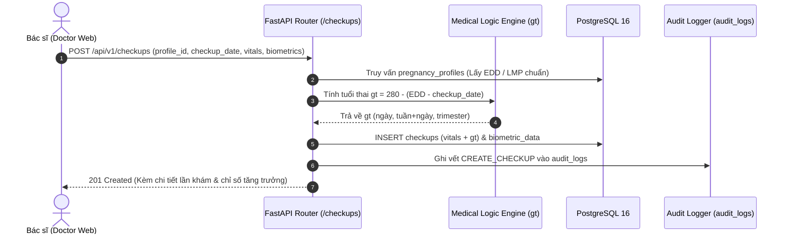
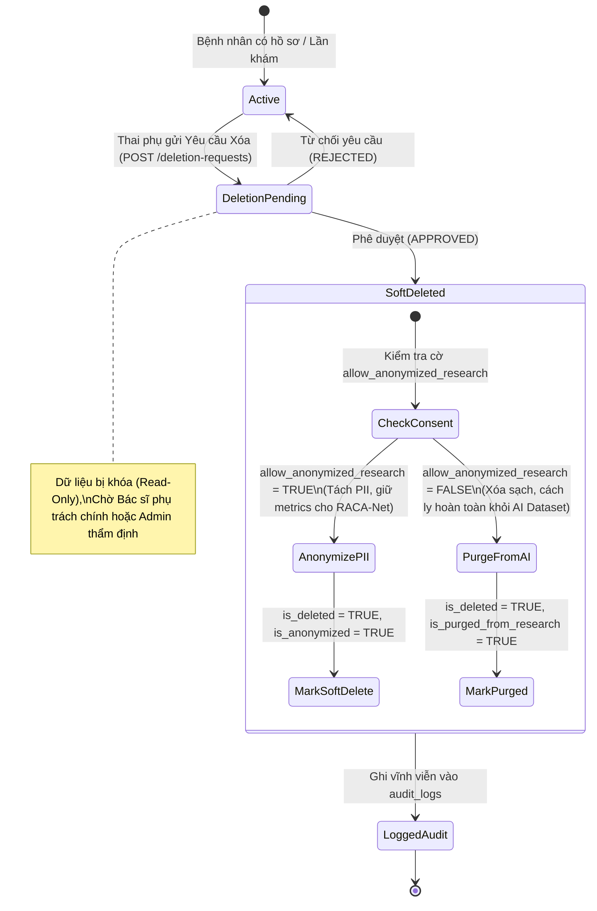

# API CONTRACT & INTERFACE SPECIFICATION
## STORY-3.2: Quản lý Chuỗi Lần khám Dọc (Visits Management)

- **Mã Story:** STORY-3.2
- **Tên Story:** Quản lý Chuỗi Lần khám Dọc (Visits Management)
- **Module:** M-RECORD (Quản lý Hồ sơ & Lịch sử Khám Thai dọc)
- **Chuẩn CSDL:** PostgreSQL 16 — Đồng bộ chính xác với sơ đồ 11 bảng của hệ thống PreCare (`checkups`, `biometric_data`, `pregnancy_profiles`, `audit_logs`).
- **Liên kết Tasks:**
  - **PRC-35 ([BE] Sub-task 3.2.1):** Thiết kế schema `visits` (`checkups`) và `biometrics` (`biometric_data`) lưu trữ chuỗi khám dọc.
  - **PRC-36 ([Web] Sub-task 3.2.2):** Giao diện Timeline hiển thị toàn bộ diễn biến các lần khám (Longitudinal History & Delta).
  - **PRC-37 ([BE/Web] Sub-task 3.2.3):** Chức năng yêu cầu xóa hồ sơ theo chuẩn bảo mật y tế (Medical Privacy & Two-Step Deletion / Anonymization).

---

## 1. SUB-TASK 3.2.1 (BACKEND): THIẾT KẾ SCHEMA CƠ SỞ DỮ LIỆU & RÀNG BUỘC LÂM SÀNG

### 1.1 Sơ đồ Bảng Chuẩn (PostgreSQL 16)

#### 1. Bảng `checkups` (Lưu thông tin các lần khám thai dọc - Visits)
Bảng trung tâm lưu trữ thông tin lâm sàng của từng lần khám thai, đóng vai trò là điểm neo thời gian ($g_t$) trong chuỗi thời gian dọc.

```sql
CREATE TABLE IF NOT EXISTS checkups (
    id UUID PRIMARY KEY DEFAULT gen_random_uuid(),
    pregnancy_profile_id UUID NOT NULL REFERENCES pregnancy_profiles(id) ON DELETE CASCADE,
    doctor_id UUID NOT NULL REFERENCES users(id),
    checkup_date DATE NOT NULL,
    gestational_age_days INT NOT NULL,        -- Tuổi thai gt tính bằng ngày tại ngày khám (tự động tính từ EDD/LMP)
    weight_kg NUMERIC(5,2),                   -- Cân nặng mẹ bầu (kg), ví dụ: 58.50
    blood_pressure_systolic INT,              -- Huyết áp tâm thu (mmHg), ví dụ: 115
    blood_pressure_diastolic INT,             -- Huyết áp tâm trương (mmHg), ví dụ: 75
    notes TEXT,                               -- Lời dặn, chẩn đoán sơ bộ của bác sĩ
    is_deleted BOOLEAN DEFAULT FALSE,         -- Hỗ trợ Soft-delete y tế (PRC-37)
    deleted_at TIMESTAMP WITH TIME ZONE,
    created_at TIMESTAMP WITH TIME ZONE DEFAULT CURRENT_TIMESTAMP,
    updated_at TIMESTAMP WITH TIME ZONE DEFAULT CURRENT_TIMESTAMP,

    -- Ràng buộc y tế hợp lý
    CONSTRAINT chk_gestational_age_range CHECK (gestational_age_days >= 0 AND gestational_age_days <= 315), -- Tối đa 45 tuần
    CONSTRAINT chk_weight_positive CHECK (weight_kg IS NULL OR (weight_kg >= 30.0 AND weight_kg <= 200.0)),
    CONSTRAINT chk_blood_pressure CHECK (
        (blood_pressure_systolic IS NULL AND blood_pressure_diastolic IS NULL) OR
        (blood_pressure_systolic > blood_pressure_diastolic AND blood_pressure_systolic >= 60 AND blood_pressure_systolic <= 250 AND blood_pressure_diastolic >= 40 AND blood_pressure_diastolic <= 150)
    )
);

CREATE INDEX IF NOT EXISTS idx_checkups_profile ON checkups(pregnancy_profile_id);
CREATE INDEX IF NOT EXISTS idx_checkups_doctor ON checkups(doctor_id);
CREATE INDEX IF NOT EXISTS idx_checkups_date ON checkups(checkup_date);
CREATE INDEX IF NOT EXISTS idx_checkups_gt ON checkups(gestational_age_days);
CREATE INDEX IF NOT EXISTS idx_checkups_not_deleted ON checkups(pregnancy_profile_id) WHERE is_deleted = FALSE;
```

---

#### 2. Bảng `biometric_data` (Lưu trữ các chỉ số siêu âm sinh trắc học thai nhi)
Liên kết 1:1 hoặc 1:N với bảng `checkups`, lưu trữ 5 chỉ số vàng ($BPD, HC, AC, FL, EFW$) để dựng đường cong tăng trưởng và cung cấp dữ liệu cho mô hình RACA-Net.

```sql
CREATE TABLE IF NOT EXISTS biometric_data (
    id UUID PRIMARY KEY DEFAULT gen_random_uuid(),
    pregnancy_profile_id UUID NOT NULL REFERENCES pregnancy_profiles(id) ON DELETE CASCADE,
    checkup_id UUID NOT NULL REFERENCES checkups(id) ON DELETE CASCADE,
    uploaded_file_id UUID REFERENCES uploaded_files(id) ON DELETE SET NULL, -- Phiếu siêu âm nguồn (nếu có từ OCR)
    gestational_age_days INT NOT NULL,        -- Đồng bộ gt với lần khám
    bpd NUMERIC(5,2),                         -- Biparietal Diameter: Đường kính lưỡng đỉnh (mm)
    hc NUMERIC(5,2),                          -- Head Circumference: Chu vi vòng đầu (mm)
    ac NUMERIC(5,2),                          -- Abdominal Circumference: Chu vi vòng bụng (mm)
    fl NUMERIC(5,2),                          -- Femur Length: Chiều dài xương đùi (mm)
    efw NUMERIC(6,2),                         -- Estimated Fetal Weight: Cân nặng thai nhi ước tính (gram)
    status VARCHAR(50) DEFAULT 'pending_verification' CHECK (status IN ('pending_verification', 'verified')),
    verified_by UUID REFERENCES users(id),    -- Bác sĩ xác thực chỉ số
    is_deleted BOOLEAN DEFAULT FALSE,         -- Hỗ trợ Soft-delete y tế (PRC-37)
    deleted_at TIMESTAMP WITH TIME ZONE,
    created_at TIMESTAMP WITH TIME ZONE DEFAULT CURRENT_TIMESTAMP,
    updated_at TIMESTAMP WITH TIME ZONE DEFAULT CURRENT_TIMESTAMP,

    -- Ràng buộc giá trị hợp lý lâm sàng
    CONSTRAINT chk_biometrics_positive CHECK (
        (bpd IS NULL OR (bpd >= 10.0 AND bpd <= 120.0)) AND
        (hc IS NULL OR (hc >= 50.0 AND hc <= 400.0)) AND
        (ac IS NULL OR (ac >= 50.0 AND ac <= 450.0)) AND
        (fl IS NULL OR (fl >= 5.0 AND fl <= 95.0)) AND
        (efw IS NULL OR (efw >= 50.0 AND efw <= 6000.0))
    )
);

CREATE INDEX IF NOT EXISTS idx_biometric_data_profile ON biometric_data(pregnancy_profile_id);
CREATE INDEX IF NOT EXISTS idx_biometric_data_checkup ON biometric_data(checkup_id);
```

---

#### 3. Bảng `deletion_requests` (Quản lý Yêu cầu Xóa Hồ sơ theo Chuẩn Y tế - PRC-37)
Để tuân thủ tiêu chuẩn bảo mật dữ liệu y tế (Mục 4.3 Kiến trúc dự án: *"Patients can request deletion of their records"*), hệ thống áp dụng luồng phê duyệt 2 bước (Two-step Deletion Workflow) thay vì hard-delete tức thời.
Hệ thống tôn trọng quyền riêng tư của thai phụ: cho phép lựa chọn giữa **Ẩn danh hóa dữ liệu cho NCKH/RACA-Net** hoặc **Từ chối lưu ẩn danh (Xóa sạch hoàn toàn khỏi mô hình nghiên cứu)**.

```sql
CREATE TABLE IF NOT EXISTS deletion_requests (
    id UUID PRIMARY KEY DEFAULT gen_random_uuid(),
    requester_id UUID NOT NULL REFERENCES users(id) ON DELETE CASCADE,
    pregnancy_profile_id UUID NOT NULL REFERENCES pregnancy_profiles(id) ON DELETE CASCADE,
    checkup_id UUID REFERENCES checkups(id) ON DELETE CASCADE, -- NULL nếu yêu cầu xóa toàn bộ hồ sơ thai kỳ
    target_type VARCHAR(50) NOT NULL CHECK (target_type IN ('full_profile', 'single_checkup')),
    reason TEXT NOT NULL,                     -- Lý do yêu cầu xóa
    allow_anonymized_research BOOLEAN DEFAULT TRUE, -- TRUE: cho phép ẩn danh hóa cho NCKH; FALSE: từ chối, xóa sạch hoàn toàn khỏi tập dữ liệu AI
    status VARCHAR(50) DEFAULT 'pending' CHECK (status IN ('pending', 'approved', 'rejected')),
    reviewed_by UUID REFERENCES users(id) ON DELETE SET NULL,  -- Bác sĩ phụ trách chính hoặc Quản trị viên duyệt
    reviewed_at TIMESTAMP WITH TIME ZONE,
    review_notes TEXT,                        -- Ghi chú phản hồi khi duyệt/từ chối
    is_anonymized BOOLEAN DEFAULT FALSE,      -- Đánh dấu dữ liệu đã được ẩn danh hóa cho nghiên cứu NCKH
    is_purged_from_research BOOLEAN DEFAULT FALSE, -- Đánh dấu dữ liệu đã bị cô lập/xóa sạch khỏi tập dữ liệu AI
    created_at TIMESTAMP WITH TIME ZONE DEFAULT CURRENT_TIMESTAMP,
    updated_at TIMESTAMP WITH TIME ZONE DEFAULT CURRENT_TIMESTAMP
);

CREATE INDEX IF NOT EXISTS idx_deletion_requests_requester ON deletion_requests(requester_id);
CREATE INDEX IF NOT EXISTS idx_deletion_requests_profile ON deletion_requests(pregnancy_profile_id);
CREATE INDEX IF NOT EXISTS idx_deletion_requests_status ON deletion_requests(status);
```

---

## 2. QUY TRÌNH NGHIỆP VỤ & TÍNH TOÁN CHUỖI KHÁM DỌC



### 2.1 Tự động Xác định Tuổi thai $g_t$ theo Ngày khám
Khi bác sĩ ghi nhận một lần khám mới (`checkup_date`), hệ thống **tuyệt đối không để bác sĩ tự nhập tuổi thai bằng tay** mà tự động nội suy từ hồ sơ thai kỳ (`pregnancy_profiles`):
$$g_t = 280 - (\text{EDD} - \text{checkup\_date})\quad (\text{đơn vị: ngày})$$
- $\text{gestational\_weeks} = \lfloor g_t / 7 \rfloor$
- $\text{gestational\_days} = g_t \pmod 7$
- Nhờ vậy, toàn bộ chuỗi khám dọc bảo đảm tính đơn điệu tăng dần theo tuổi thai: $g_1 < g_2 < \dots < g_T$.

### 2.2 Tính toán Biến thiên Tăng trưởng (Delta Calculations)
Trong giao diện Timeline (PRC-36), hệ thống tự động so sánh lần khám hiện tại ($k$) với lần khám trước liền kề ($k-1$):
- **Khoảng cách khám:** $\Delta g_t = g_t^{(k)} - g_t^{(k-1)}$ (ngày/tuần).
- **Mức tăng cân của mẹ:** $\Delta W = W^{(k)} - W^{(k-1)}$ (kg).
- **Tốc độ tăng trưởng thai nhi:**
  - $\Delta \text{EFW} = \text{EFW}^{(k)} - \text{EFW}^{(k-1)}$ (gram).
  - Tốc độ tăng cân trung bình: $\frac{\Delta \text{EFW}}{\Delta g_t / 7}$ (gram/tuần).

---

## 3. SUB-TASK 3.2.3: CHUẨN BẢO MẬT XÓA HỒ SƠ Y TẾ (DATA ERASURE & ANONYMIZATION)

Căn cứ Mục 4.3 Tài liệu Kiến trúc Hệ thống (*"Patients can request deletion of their records; data used for training is anonymized"*), quy trình xử lý xóa hồ sơ tuân thủ nguyên tắc:



1. **Khóa tạm thời (Pending Deletion):** Hồ sơ/lần khám bị gắn cờ yêu cầu xóa, tạm thời ẩn khỏi màn hình theo dõi định kỳ của mẹ bầu, không cho phép chỉnh sửa.
2. **Quyền hạn Thẩm định & Phê duyệt (Approval Authorization):**
   - **Bác sĩ phụ trách chính (`primary_doctor_id`):** Là người trực tiếp theo dõi thai kỳ, hiểu rõ hồ sơ bệnh án của sản phụ, có thẩm quyền xác nhận và phê duyệt yêu cầu xóa hồ sơ của bệnh nhân mình phụ trách.
   - **Quản trị viên (`admin`):** Thẩm quyền cấp hệ thống để giải quyết các trường hợp khiếu nại hoặc bác sĩ phụ trách đã rời cơ sở y tế.
   - *Bác sĩ không phụ trách hồ sơ sẽ bị hệ thống từ chối truy cập (HTTP 403 Forbidden).*
3. **Quyền lựa chọn Ẩn danh hóa hay Xóa sạch khỏi Mô hình Nghiên cứu (Patient Consent):**
   - **Lựa chọn 1 (`allow_anonymized_research = TRUE`):** Tách bỏ toàn bộ thông tin định danh cá nhân (PII: Họ tên, SĐT, Email). Các chuỗi số đo sinh trắc học dọc ($g_t, BPD, HC, AC, FL, EFW$) được giữ lại dưới dạng phi định danh phục vụ công tác NCKH và tối ưu hóa mô hình AI RACA-Net.
   - **Lựa chọn 2 (`allow_anonymized_research = FALSE`):** Bệnh nhân từ chối cung cấp dữ liệu cho nghiên cứu. Hệ thống sẽ soft-delete hồ sơ lâm sàng đồng thời đánh dấu `is_purged_from_research = TRUE`, loại bỏ hoàn toàn các chuỗi đo này khỏi bất kỳ pipeline huấn luyện, validation hay đánh giá nào của mô hình RACA-Net.
4. **Audit Trail Bắt buộc:** Hành động xóa bắt buộc phải ghi lại ID người duyệt, lý do xóa, trạng thái consent và địa chỉ IP vào bảng `audit_logs` để bảo đảm tính pháp lý y tế.

---

## 4. CHI TIẾT REST API CONTRACT

- **Base URL:** `/api/v1`
- **Mã hóa:** `application/json`
- **Xác thực:** Header `Authorization: Bearer <access_token>`

---

### 4.1 Danh sách Endpoints

| Method | Endpoint | Quyền hạn (RBAC) | Mô tả tóm tắt |
| :--- | :--- | :--- | :--- |
| `POST` | `/api/v1/checkups` | `doctor` | Thêm lần khám mới (kèm sinh hiệu & chỉ số sinh trắc học) |
| `GET` | `/api/v1/checkups/{checkup_id}` | `doctor`, `pregnant_woman` | Lấy chi tiết thông tin một lần khám cụ thể |
| `PUT` | `/api/v1/checkups/{checkup_id}` | `doctor` | Cập nhật sinh hiệu, lời dặn của lần khám |
| `GET` | `/api/v1/pregnancy-profiles/{profile_id}/timeline` | `doctor`, `pregnant_woman` | **Lấy toàn bộ chuỗi khám dọc (Timeline) & Delta tăng trưởng** |
| `POST` | `/api/v1/checkups/{checkup_id}/biometrics` | `doctor` | Bổ sung/cập nhật chỉ số siêu âm thai cho lần khám |
| `POST` | `/api/v1/deletion-requests` | `pregnant_woman` | **Gửi yêu cầu xóa hồ sơ/lần khám kèm tùy chọn ẩn danh hóa NCKH** |
| `GET` | `/api/v1/deletion-requests` | `doctor` (bác sĩ phụ trách), `admin` | Xem danh sách các yêu cầu xóa hồ sơ đang chờ duyệt |
| `PATCH`| `/api/v1/deletion-requests/{request_id}/review` | `doctor` (bác sĩ phụ trách chính), `admin` | Phê duyệt hoặc từ chối yêu cầu xóa hồ sơ |

---

### 4.2 Chi tiết từng Endpoint

#### 1. `POST /api/v1/checkups` — Tạo Mới Một Lần Khám (Visit)
- **Role áp dụng:** `doctor`
- **Request Body (JSON):**
```json
{
  "pregnancy_profile_id": "7b8e9f10-5a3d-4c21-b0e4-9876543210ab",
  "checkup_date": "2026-10-29",
  "weight_kg": 58.5,
  "blood_pressure_systolic": 115,
  "blood_pressure_diastolic": 75,
  "notes": "Mẹ bầu sức khỏe tốt, thai máy đều. Hẹn tái khám sau 4 tuần.",
  "biometrics": {
    "bpd": 45.2,
    "hc": 168.0,
    "ac": 149.5,
    "fl": 32.1,
    "efw": 380.0
  }
}
```

- **Response 201 Created:**
```json
{
  "success": true,
  "data": {
    "id": "e2f1a304-8b1c-4e67-9d2a-112233445566",
    "pregnancy_profile_id": "7b8e9f10-5a3d-4c21-b0e4-9876543210ab",
    "doctor": {
      "id": "d15c7a32-1e44-4829-9e88-4c123d567890",
      "full_name": "BS. Trần Văn B"
    },
    "checkup_date": "2026-10-29",
    "gestational_age": {
      "days": 150,
      "weeks": 21,
      "remaining_days": 3,
      "formatted": "21w3d",
      "trimester": 2
    },
    "vitals": {
      "weight_kg": 58.5,
      "blood_pressure_systolic": 115,
      "blood_pressure_diastolic": 75,
      "blood_pressure_status": "normal"
    },
    "notes": "Mẹ bầu sức khỏe tốt, thai máy đều. Hẹn tái khám sau 4 tuần.",
    "biometric_data": {
      "id": "f8a9b0c1-2d3e-4f5a-6b7c-8d9e0f1a2b3c",
      "bpd": 45.2,
      "hc": 168.0,
      "ac": 149.5,
      "fl": 32.1,
      "efw": 380.0,
      "status": "verified"
    },
    "created_at": "2026-10-29T10:30:00Z"
  },
  "message": "Ghi nhận lần khám thành công"
}
```

---

#### 2. `GET /api/v1/pregnancy-profiles/{profile_id}/timeline` — Chuỗi Khám Dọc & Diễn biến (PRC-36)
Endpoint cung cấp dữ liệu cho giao diện Timeline diễn biến khám thai trên Web Bác sĩ và Mobile Thai phụ.

- **Query Parameters:**
  - `order`: `"asc"` | `"desc"` (mặc định: `"asc"` theo thời gian để vẽ biểu đồ và xem diễn biến tiến trình).
- **Response 200 OK:**
```json
{
  "success": true,
  "data": {
    "pregnancy_profile_id": "7b8e9f10-5a3d-4c21-b0e4-9876543210ab",
    "patient_name": "Nguyễn Thị A",
    "edd": "2027-03-08",
    "total_visits": 2,
    "timeline_items": [
      {
        "checkup_id": "99a8b7c6-1d2e-3f4a-5b6c-7d8e9f0a1b2c",
        "checkup_date": "2026-09-28",
        "gestational_age": {
          "days": 119,
          "weeks": 17,
          "remaining_days": 0,
          "formatted": "17w0d",
          "trimester": 2
        },
        "vitals": {
          "weight_kg": 56.0,
          "blood_pressure": "110/70"
        },
        "biometrics": {
          "bpd": 37.0,
          "hc": 138.0,
          "ac": 118.0,
          "fl": 24.0,
          "efw": 190.0,
          "status": "verified"
        },
        "delta": null,
        "doctor_name": "BS. Trần Văn B",
        "notes": "Lần khám định kỳ tháng thứ 4."
      },
      {
        "checkup_id": "e2f1a304-8b1c-4e67-9d2a-112233445566",
        "checkup_date": "2026-10-29",
        "gestational_age": {
          "days": 150,
          "weeks": 21,
          "remaining_days": 3,
          "formatted": "21w3d",
          "trimester": 2
        },
        "vitals": {
          "weight_kg": 58.5,
          "blood_pressure": "115/75"
        },
        "biometrics": {
          "bpd": 45.2,
          "hc": 168.0,
          "ac": 149.5,
          "fl": 32.1,
          "efw": 380.0,
          "status": "verified"
        },
        "delta": {
          "days_since_last_visit": 31,
          "weight_gain_kg": 2.5,
          "efw_growth_gram": 190.0,
          "weekly_fetal_growth_gram": 42.9
        },
        "doctor_name": "BS. Trần Văn B",
        "notes": "Mẹ bầu sức khỏe tốt, thai máy đều. Hẹn tái khám sau 4 tuần."
      }
    ]
  }
}
```

---

#### 3. `POST /api/v1/deletion-requests` — Yêu Cầu Xóa Hồ Sơ / Lần Khám (PRC-37)
- **Role áp dụng:** `pregnant_woman` (Chính chủ hồ sơ)
- **Request Body (JSON):**
```json
{
  "pregnancy_profile_id": "7b8e9f10-5a3d-4c21-b0e4-9876543210ab",
  "checkup_id": null,
  "target_type": "full_profile",
  "reason": "Tôi đã chuyển sang theo dõi thai kỳ tại bệnh viện quốc tế và có nguyện vọng xóa dữ liệu cá nhân theo quy định quyền riêng tư.",
  "allow_anonymized_research": false
}
```
*Ghi chú các trường:*
- `target_type`: `"full_profile"` (toàn bộ hồ sơ thai kỳ) hoặc `"single_checkup"` (xóa một lần khám cụ thể do sai lệch).
- `allow_anonymized_research` (boolean, mặc định: `true`):
  - `true`: Cho phép hệ thống giữ lại các chỉ số đo sinh trắc học ở dạng phi định danh để đóng góp dữ liệu cho nghiên cứu AI/RACA-Net.
  - `false`: Từ chối hoàn toàn, yêu cầu xóa sạch và cô lập dữ liệu (Purge) khỏi mọi tập dữ liệu nghiên cứu khoa học.

- **Response 201 Created:**
```json
{
  "success": true,
  "data": {
    "request_id": "3a4b5c6d-7e8f-9a0b-1c2d-3e4f5a6b7c8d",
    "target_type": "full_profile",
    "allow_anonymized_research": false,
    "status": "pending",
    "created_at": "2026-10-29T11:00:00Z"
  },
  "message": "Yêu cầu xóa hồ sơ đã được tiếp nhận và chuyển đến Bác sĩ phụ trách chính/Quản trị viên xét duyệt theo quy định bảo mật dữ liệu y tế."
}
```

---

#### 4. `PATCH /api/v1/deletion-requests/{request_id}/review` — Xét Duyệt Xóa Hồ Sơ (PRC-37)
- **Role áp dụng & Thẩm quyền (RBAC):**
  - **Quản trị viên (`admin`)** HOẶC **Bác sĩ phụ trách chính (`primary_doctor_id`)** của hồ sơ thai kỳ này (`current_user.id == pregnancy_profile.primary_doctor_id`).
  - *Nếu bác sĩ khác thực hiện duyệt:* Backend chặn bằng lỗi `403 Forbidden` (`"Chỉ bác sĩ phụ trách chính của hồ sơ thai kỳ hoặc quản trị viên mới có thẩm quyền phê duyệt yêu cầu xóa này"`).
- **Request Body (JSON):**
```json
{
  "status": "approved",
  "review_notes": "Đã đối chiếu với bệnh nhân, xác nhận đồng ý xóa hồ sơ và cách ly khỏi tập dữ liệu nghiên cứu theo đúng nguyện vọng."
}
```
*(Nếu từ chối xóa: gửi `status = "rejected"` kèm `review_notes` giải thích lý do từ chối)*

- **Cơ chế thực thi khi Approved:**
  - Đánh dấu `is_deleted = TRUE` và `deleted_at = NOW()` trên các bảng liên quan (`checkups`, `biometric_data`, `pregnancy_profiles`).
  - **Dựa vào lựa chọn của bệnh nhân (`allow_anonymized_research`):**
    - Nếu `allow_anonymized_research = true`: Đánh dấu `is_anonymized = TRUE`, tách bỏ toàn bộ thông tin PII, giữ chuỗi dữ liệu ẩn danh cho mô hình RACA-Net.
    - Nếu `allow_anonymized_research = false`: Đánh dấu `is_purged_from_research = TRUE`, loại bỏ hoàn toàn và vĩnh viễn khỏi bất kỳ tập dữ liệu huấn luyện hoặc đánh giá nào của mô hình RACA-Net.
  - Ghi vết hành động duyệt xóa vào `audit_logs` với action `"APPROVE_MEDICAL_DELETION"`, lưu trữ ID người duyệt, địa chỉ IP và lý do y khoa.

- **Response 200 OK:**
```json
{
  "success": true,
  "data": {
    "request_id": "3a4b5c6d-7e8f-9a0b-1c2d-3e4f5a6b7c8d",
    "status": "approved",
    "reviewed_by": {
      "id": "d15c7a32-1e44-4829-9e88-4c123d567890",
      "full_name": "BS. Trần Văn B",
      "role": "doctor"
    },
    "is_anonymized": false,
    "is_purged_from_research": true,
    "reviewed_at": "2026-10-29T11:30:00Z"
  },
  "message": "Đã phê duyệt yêu cầu xóa hồ sơ y tế thành công. Dữ liệu đã được xử lý xóa mềm và cách ly khỏi mô hình nghiên cứu theo đúng chỉ định."
}
```

---

## 5. SUB-TASK 3.2.2 & 3.2.3 (FRONTEND WEB & MOBILE): INTERFACES & UI/UX

### 5.1 Định nghĩa TypeScript Interfaces

```typescript
// types/checkup.ts

export interface GestationalAgeInfo {
  days: number;
  weeks: number;
  remainingDays: number;
  formatted: string;
  trimester: 1 | 2 | 3;
}

export interface MaternalVitals {
  weightKg?: number;
  bloodPressureSystolic?: number;
  bloodPressureDiastolic?: number;
  bloodPressureStatus?: 'normal' | 'elevated' | 'stage1_hypertension' | 'crisis';
}

export interface BiometricMeasurements {
  id?: string;
  bpd?: number;  // mm
  hc?: number;   // mm
  ac?: number;   // mm
  fl?: number;   // mm
  efw?: number;  // gram
  status: 'pending_verification' | 'verified';
}

export interface VisitDelta {
  daysSinceLastVisit: number;
  weightGainKg: number;
  efwGrowthGram?: number;
  weeklyFetalGrowthGram?: number;
}

export interface TimelineItem {
  checkupId: string;
  checkupDate: string;
  gestationalAge: GestationalAgeInfo;
  vitals: MaternalVitals;
  biometrics?: BiometricMeasurements;
  delta?: VisitDelta | null;
  doctorName: string;
  notes?: string;
}

export interface LongitudinalTimelineResponse {
  pregnancyProfileId: string;
  patientName: string;
  edd: string;
  totalVisits: number;
  timelineItems: TimelineItem[];
}

export interface CreateCheckupRequest {
  pregnancyProfileId: string;
  checkupDate: string;
  weightKg?: number;
  bloodPressureSystolic?: number;
  bloodPressureDiastolic?: number;
  notes?: string;
  biometrics?: {
    bpd?: number;
    hc?: number;
    ac?: number;
    fl?: number;
    efw?: number;
  };
}

export interface DeletionRequestPayload {
  pregnancyProfileId: string;
  checkupId?: string | null;
  targetType: 'full_profile' | 'single_checkup';
  reason: string;
  allowAnonymizedResearch: boolean; // true: ẩn danh hóa cho AI; false: xóa sạch hoàn toàn khỏi mô hình nghiên cứu
}

export interface ReviewDeletionPayload {
  status: 'approved' | 'rejected';
  reviewNotes?: string;
}
```

---

### 5.2 Đặc tả Giao diện Timeline (PRC-36)

#### A. Web Bác Sĩ (Doctor Web Timeline)
1. **Bố cục Trực quan:**
   - Trục thời gian dạng thẳng đứng (Vertical Timeline) nối giữa các mốc khám.
   - Mỗi mốc là một **Visit Card**:
     - Tiêu đề mốc: Badge tuổi thai to rõ (ví dụ: `21w3d` - Quý 2) kèm ngày khám.
     - Khối Sinh hiệu mẹ: Cân nặng ($58.5\text{ kg}$, hiện kèm tag `+2.5 kg` so với lần trước), Huyết áp ($115/75\text{ mmHg}$).
     - Bảng Chỉ số thai nhi (Biometrics Grid): BPD, HC, AC, FL, EFW.
     - Lời dặn lâm sàng và nút `+ Thêm phiếu cận lâm sàng / OCR`.
2. **Cảnh báo Lâm sàng Tích hợp:**
   - Nếu huyết áp tâm thu $\ge 140$ hoặc tâm trương $\ge 90$: Hiển thị thẻ màu vàng/đỏ cảnh báo nguy cơ tiền sản giật (*Preeclampsia Alert*).
   - Nếu thai chậm tăng trưởng ($\Delta \text{EFW}$ dưới bách phân vị chuẩn): Hiển thị cảnh báo cần chú ý dinh dưỡng/siêu âm doppler.

#### B. Mobile App Thai Phụ (Patient Mobile Timeline)
1. **Thiết kế Nhật ký Thai kỳ:**
   - Hiển thị theo phong cách Storybook / Milestone thân thiện: *"Lần khám tuần thứ 21 của bé"*.
   - Đổi các từ ngữ chuyên môn thành từ dễ hiểu: `BPD` (Đường kính đầu bé), `FL` (Chiều dài xương đùi), `EFW` (Cân nặng dự tính).
   - Nút hành động an toàn: `Yêu cầu điều chỉnh hoặc Xóa phiếu khám` mở Modal PRC-37.

---

### 5.3 Giao diện Yêu cầu Xóa Hồ sơ Y tế (PRC-37)
- **Modal Thai Phụ gửi Yêu Cầu Xóa (Mobile / Web):**
  - Cảnh báo quyền lợi: *"Theo quy định của Luật Y tế, việc xóa hồ sơ sẽ chấm dứt việc theo dõi sức khỏe liên tục trên ứng dụng."*
  - Ô nhập lý do xóa (Bắt buộc, tối thiểu 10 ký tự).
  - **Checkbox Quyền Riêng tư NCKH:** 
    - `[x] Tôi đồng ý ẩn danh hóa dữ liệu cận lâm sàng (không kèm tên/SĐT) để phục vụ nghiên cứu khoa học (Mô hình RACA-Net).`
    - *Nếu bỏ chọn:* Hệ thống ghi nhận yêu cầu xóa sạch hoàn toàn, không đưa dữ liệu vào tập huấn luyện của AI.
  - Xác thực bảo mật: Yêu cầu nhập lại mật khẩu tài khoản trước khi gửi yêu cầu.
- **Màn hình Xét Duyệt Dành Cho Bác Sĩ Phụ Trách & Quản Trị Viên (Doctor Web / Admin Portal):**
  - Bác sĩ phụ trách chính (`primary_doctor_id`) được cấp quyền xem và xét duyệt các yêu cầu xóa thuộc hồ sơ mình theo dõi.
  - Quản trị viên (`admin`) có thể xem và duyệt toàn bộ các yêu cầu trên hệ thống.
  - Hiển thị rõ lý do xóa, lựa chọn đồng ý/từ chối ẩn danh của bệnh nhân, và ô nhập ghi chú lâm sàng khi đưa ra quyết định Duyệt / Từ chối.

---

## 6. MA TRẬN VALIDATION VÀ QUY CHUẨN LÂM SÀNG

| Trường dữ liệu | Định dạng / Phạm vi | Ràng buộc Nghiệp vụ Lâm sàng | Xử lý lỗi |
| :--- | :--- | :--- | :--- |
| `checkup_date` | Date (`YYYY-MM-DD`) | $\le$ Ngày hiện tại; phải sau ngày phát hiện có thai / LMP. | `422`: Ngày khám không được ở tương lai. |
| `weight_kg` | $30.0 \le W \le 200.0$ | Cân nặng chuẩn người trưởng thành mang thai. | `422`: Cân nặng nằm ngoài giới hạn sinh lý bình thường. |
| Huyết áp | Systolic: $60-250$, Diastolic: $40-150$ | Huyết áp tâm thu phải lớn hơn huyết áp tâm trương. | `422`: Chỉ số huyết áp không hợp lệ (Tâm thu phải > Tâm trương). |
| `bpd`, `hc`, `ac`, `fl` | Decimal (mm) | Phải là số dương; nằm trong ngưỡng đo siêu âm thai kỳ tiêu chuẩn. | `422`: Kích thước sinh trắc học vượt ngưỡng đo lâm sàng. |
| `reason` (Xóa) | Text (tối thiểu 10 ký tự) | Bắt buộc phải có lý do minh bạch phục vụ lưu vết y khoa. | `400`: Lý do yêu cầu xóa không được để trống. |

---

*Tài liệu này hoàn thiện hợp đồng API cho Story-3.2, tương thích 100% với kịch bản CSDL 11 bảng PreCare, các quy định an toàn y tế và kiến trúc FastAPI Backend Gateway.*
