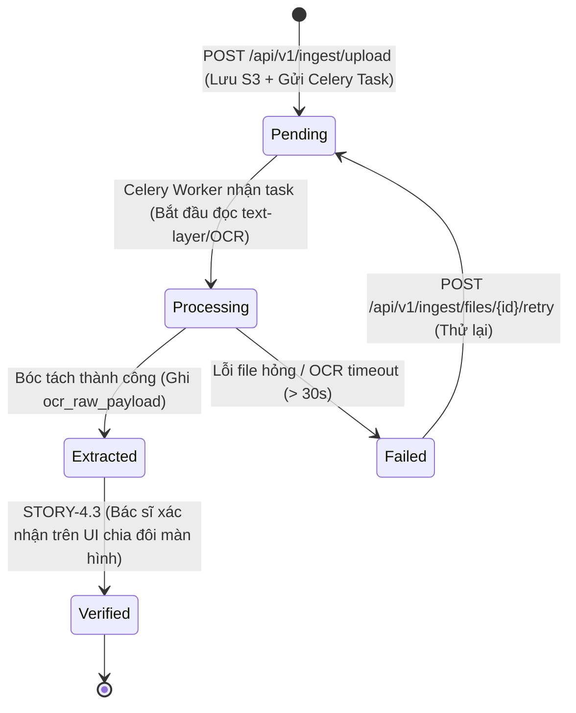
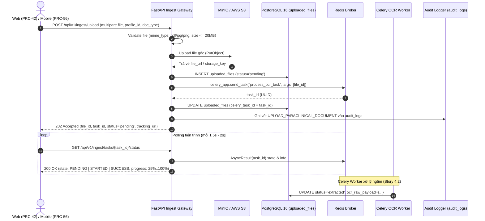

# API CONTRACT & INTERFACE SPECIFICATION
## STORY-4.1: Tải lên Phiếu Khám & Hàng đợi Xử lý (Paraclinical Document Upload & Processing Queue)

- **Mã Story:** STORY-4.1
- **Tên Story:** Tải lên Phiếu Khám & Hàng đợi Xử lý
- **Module:** M-INGEST (Tiếp nhận Tài liệu Cận Lâm Sàng & Xử lý Bất đồng bộ)
- **Chuẩn CSDL:** PostgreSQL 16 — Đồng bộ chính xác với sơ đồ 11 bảng của hệ thống PreCare (`uploaded_files`, `pregnancy_profiles`, `checkups`, `users`, `audit_logs`).
- **Hạ tầng Tích hợp:**
  - **Object Storage:** MinIO / AWS S3 (S3-compatible API) — Lưu trữ tài liệu gốc nguyên bản (Raw Documents) phục vụ đối chiếu y tế và pháp lý.
  - **Task Queue & Broker:** Celery + Redis — Tiếp nhận và xử lý bất đồng bộ các tác vụ trích xuất (Text Layer Parser & OCR Engine) với ngân sách thời gian lên đến 30 giây (Section 4.1 Kiến trúc).
- **Liên kết Tasks:**
  - **PRC-42 ([Web] Sub-task 4.1.1):** Component upload kéo thả file (PDF, ảnh JPG/PNG) & thanh tiến trình (Progress Bar & Status Polling).
  - **PRC-43 ([BE] Sub-task 4.1.3):** Lưu file gốc vào Object Storage (MinIO/S3), tạo bản ghi `uploaded_files`, sinh task Celery.
  - **PRC-56 ([App] Sub-task 4.1.2):** Chức năng chọn/chụp ảnh phiếu khám từ Camera / Photo Library & tải lên trên Mobile App.

---

## 1. SUB-TASK 4.1.3 (BACKEND): THIẾT KẾ CƠ SỞ DỮ LIỆU & QUY TRÌNH HÀNG ĐỢI

### 1.1 Sơ đồ Bảng Chuẩn `uploaded_files` (PostgreSQL 16)

Trích xuất trực tiếp từ [PrecareDatabase.txt](file:///d:/IT/NCKH/document/PreCareDatabase.txt):

```sql
CREATE TABLE IF NOT EXISTS uploaded_files (
    id UUID PRIMARY KEY DEFAULT gen_random_uuid(),
    pregnancy_profile_id UUID NOT NULL REFERENCES pregnancy_profiles(id) ON DELETE CASCADE,
    checkup_id UUID REFERENCES checkups(id) ON DELETE SET NULL, -- Gắn với lần khám nếu tải lên trong buổi khám
    file_url VARCHAR(512) NOT NULL,                           -- Đường dẫn Object Storage (S3/MinIO key hoặc URI)
    file_type VARCHAR(50) NOT NULL,                           -- Loại file: 'application/pdf', 'image/jpeg', 'image/png'
    file_name VARCHAR(255),                                   -- Tên file gốc người dùng tải lên
    file_size_bytes BIGINT,                                   -- Dung lượng file (bytes)
    document_type VARCHAR(50) DEFAULT 'ultrasound_report'     -- 'ultrasound_report', 'blood_test', 'urinalysis', 'other'
        CHECK (document_type IN ('ultrasound_report', 'blood_test', 'urinalysis', 'other')),
    status VARCHAR(50) DEFAULT 'pending' 
        CHECK (status IN ('pending', 'processing', 'extracted', 'verified', 'failed')),
    celery_task_id VARCHAR(100),                              -- ID của Celery Task xử lý ngầm trong Redis
    error_message TEXT,                                       -- Lưu thông báo lỗi nếu quá trình OCR/Extract thất bại
    ocr_raw_payload JSONB,                                    -- Kết quả bóc tách thô (sẽ do Celery worker ghi ở Story 4.2)
    uploaded_by UUID REFERENCES users(id),                    -- Người tải lên (Bác sĩ hoặc Thai phụ)
    created_at TIMESTAMP WITH TIME ZONE DEFAULT CURRENT_TIMESTAMP,
    updated_at TIMESTAMP WITH TIME ZONE DEFAULT CURRENT_TIMESTAMP
);

CREATE INDEX IF NOT EXISTS idx_uploaded_files_profile ON uploaded_files(pregnancy_profile_id);
CREATE INDEX IF NOT EXISTS idx_uploaded_files_checkup ON uploaded_files(checkup_id);
CREATE INDEX IF NOT EXISTS idx_uploaded_files_status ON uploaded_files(status);
CREATE INDEX IF NOT EXISTS idx_uploaded_files_task ON uploaded_files(celery_task_id);
```

---

### 1.2 Vòng đời Trạng thái File (`status`)



- **`pending`**: File đã lưu thành công vào MinIO/S3, bản ghi đã tạo trong PostgreSQL, task đã đưa vào Redis Broker.
- **`processing`**: Worker Celery bắt đầu bóc tách (phân tích bảng, layout parser, OCR image).
- **`extracted`**: Bóc tách dữ liệu thô thành công, lưu vào trường `ocr_raw_payload`. Sẵn sàng cho Doctor Confirmation Barrier (Story 4.3).
- **`verified`**: Bác sĩ đã đối chiếu bản gốc và xác nhận chỉ số, chuyển dữ liệu vào bảng lâm sàng chính thức (`biometric_data`).
- **`failed`**: Lỗi xử lý (ảnh quá mờ, định dạng không hỗ trợ, lỗi timeout worker).

---

### 1.3 Cấu trúc Lưu trữ trên Object Storage (MinIO / S3)

File gốc được lưu với quy ước định danh bất biến (Immutable Storage Key) nhằm phục vụ đối chiếu y tế và truy vết pháp lý:
$$\text{Storage Key: } \texttt{paraclinical-documents/\{patient\_id\}/\{pregnancy\_profile\_id\}/\{file\_uuid\}.\{ext\}}$$
- **Bucket mặc định:** `precare-paraclinical-docs`
- **Chính sách truy cập:** Private (Truy cập thông qua Presigned URL có thời hạn tối đa 30 phút).

---

## 2. QUY TRÌNH TIẾP NHẬN & XỬ LÝ BẤT ĐỒNG BỘ (ASYNC INGESTION PIPELINE)



---

## 3. CHI TIẾT REST API CONTRACT

- **Base URL:** `/api/v1/ingest`
- **Mã hóa:** `multipart/form-data` (cho Upload) và `application/json` (cho Tra cứu & Quản lý)
- **Xác thực:** Header `Authorization: Bearer <access_token>`

---

### 3.1 Danh sách Endpoints

| Method | Endpoint | Quyền hạn (RBAC) | Mô tả tóm tắt |
| :--- | :--- | :--- | :--- |
| `POST` | `/api/v1/ingest/upload` | `doctor`, `pregnant_woman` | **Tải lên đơn lẻ phiếu khám cận lâm sàng & sinh task xử lý** |
| `POST` | `/api/v1/ingest/upload-batch` | `doctor`, `pregnant_woman` | **Tải lên hàng loạt nhiều phiếu khám cùng lúc (Batch Upload)** |
| `GET` | `/api/v1/ingest/tasks/{task_id}/status` | All Authenticated Users | **Polling tiến trình xử lý tác vụ Celery đơn lẻ (Progress Bar)** |
| `GET` | `/api/v1/ingest/batches/{batch_id}/status` | All Authenticated Users | **Polling tiến trình tổng hợp của đợt tải hàng loạt (Batch Progress)** |
| `GET` | `/api/v1/ingest/files/{file_id}` | `doctor`, `pregnant_woman` | Xem chi tiết file & lấy Presigned URL xem trước bản gốc |
| `GET` | `/api/v1/ingest/profiles/{profile_id}/files` | `doctor`, `pregnant_woman` | Danh sách tài liệu đã tải lên của hồ sơ thai kỳ |
| `DELETE`| `/api/v1/ingest/files/{file_id}` | `doctor`, `pregnant_woman` | Xóa file tải lên nhầm (khi status là `pending` hoặc `failed`) |
| `POST` | `/api/v1/ingest/files/{file_id}/retry` | `doctor`, `pregnant_woman` | Thử lại quá trình trích xuất nếu task Celery bị `failed` |

---

### 3.2 Đặc tả Chi tiết từng Endpoint

#### 1. `POST /api/v1/ingest/upload` — Tải lên Phiếu Khám & Kích hoạt Hàng đợi
- **Content-Type:** `multipart/form-data`
- **Form Fields:**
  - `file` (File, Bắt buộc): File PDF hoặc ảnh (`.pdf`, `.jpg`, `.jpeg`, `.png`), tối đa 20MB.
  - `pregnancy_profile_id` (UUID, Bắt buộc): ID hồ sơ thai kỳ cần gắn tài liệu.
  - `checkup_id` (UUID, Tùy chọn): ID lần khám nếu tài liệu được tải lên trong buổi khám cụ thể.
  - `document_type` (String, Tùy chọn): Loại tài liệu (`"ultrasound_report"`, `"blood_test"`, `"urinalysis"`, `"other"`, mặc định `"ultrasound_report"`).

- **Response 202 Accepted:**
```json
{
  "success": true,
  "data": {
    "file_id": "a1b2c3d4-e5f6-7a8b-9c0d-112233445566",
    "task_id": "c7d8e9f0-1a2b-3c4d-5e6f-778899aabbcc",
    "pregnancy_profile_id": "7b8e9f10-5a3d-4c21-b0e4-9876543210ab",
    "checkup_id": null,
    "file_name": "phieu_sieu_am_20w.jpg",
    "file_type": "image/jpeg",
    "file_size_bytes": 2458912,
    "document_type": "ultrasound_report",
    "status": "pending",
    "tracking_url": "/api/v1/ingest/tasks/c7d8e9f0-1a2b-3c4d-5e6f-778899aabbcc/status",
    "created_at": "2026-10-29T11:45:00Z"
  },
  "message": "Tải tài liệu lên thành công. Tác vụ trích xuất dữ liệu đang được xử lý trong hàng đợi ngầm."
}
```

- **Mã lỗi phản hồi:**
  - `400 Bad Request`: Định dạng file không hợp lệ (không phải PDF/JPG/PNG) hoặc vượt quá 20MB.
  - `404 Not Found`: Không tìm thấy `pregnancy_profile_id` hoặc hồ sơ đã bị kết thúc/xóa.
  - `413 Payload Too Large`: Dung lượng file vượt quá giới hạn hệ thống cho phép (20MB).

---

#### 2. `POST /api/v1/ingest/upload-batch` — Tải lên Hàng loạt Nhiều Phiếu Khám (Batch Upload)
Hỗ trợ bác sĩ kéo thả cùng lúc nhiều tài liệu (ví dụ: 3 phiếu siêu âm của các tuần khác nhau hoặc kết quả siêu âm + xét nghiệm máu) hoặc mẹ bầu chọn nhiều ảnh từ thư viện.

- **Content-Type:** `multipart/form-data`
- **Form Fields:**
  - `files` (Array of Files, Bắt buộc): Danh sách từ 1 đến 10 files (PDF, JPG, PNG; mỗi file $\le 20\text{MB}$).
  - `pregnancy_profile_id` (UUID, Bắt buộc): ID hồ sơ thai kỳ.
  - `checkup_id` (UUID, Tùy chọn): ID lần khám nếu tải trong phiên khám.
  - `document_type` (String, Tùy chọn): Loại tài liệu mặc định cho nhóm file (hoặc hệ thống tự phân loại).

- **Xử lý Backend:**
  - Duyệt và kiểm tra tính hợp lệ của từng file trong mảng.
  - Upload song song lên MinIO Storage.
  - Tạo từng bản ghi `uploaded_files` và sinh các task Celery độc lập tương ứng.
  - Gộp thành một mã `batch_id` để tiện theo dõi tổng thể.

- **Response 202 Accepted:**
```json
{
  "success": true,
  "data": {
    "batch_id": "9d8e7f6a-5b4c-3d2e-1f0a-aabbccddeeff",
    "total_files": 2,
    "successful_enqueued": 2,
    "failed_enqueued": 0,
    "tracking_url": "/api/v1/ingest/batches/9d8e7f6a-5b4c-3d2e-1f0a-aabbccddeeff/status",
    "items": [
      {
        "file_id": "a1b2c3d4-e5f6-7a8b-9c0d-112233445566",
        "task_id": "c7d8e9f0-1a2b-3c4d-5e6f-778899aabbcc",
        "file_name": "sieu_am_20w.jpg",
        "file_size_bytes": 2458912,
        "status": "pending"
      },
      {
        "file_id": "b2c3d4e5-f6a7-8b9c-0d1e-223344556677",
        "task_id": "d8e9f0a1-2b3c-4d5e-6f7a-8899aabbccdd",
        "file_name": "sieu_am_24w.pdf",
        "file_size_bytes": 4194304,
        "status": "pending"
      }
    ]
  },
  "message": "Đã tiếp nhận 2/2 tài liệu vào hàng đợi xử lý trích xuất ngầm."
}
```

---

#### 3. `GET /api/v1/ingest/tasks/{task_id}/status` — Polling Tiến trình Tác vụ Đơn lẻ (PRC-42 & PRC-56)
Endpoint nhẹ được tối ưu hóa cho Client gọi tuần tự mỗi 1.5s - 2s để cập nhật thanh tiến trình giao diện người dùng.

- **Response 200 OK (Đang xử lý - Stage: Extracting):**
```json
{
  "success": true,
  "data": {
    "task_id": "c7d8e9f0-1a2b-3c4d-5e6f-778899aabbcc",
    "file_id": "a1b2c3d4-e5f6-7a8b-9c0d-112233445566",
    "state": "PROCESSING",
    "progress_percentage": 65,
    "current_stage": "extracting_ocr_layout",
    "stage_message": "Đang phân tích bảng biểu và nhận dạng chỉ số sinh trắc học...",
    "estimated_seconds_remaining": 6
  }
}
```

- **Response 200 OK (Hoàn tất thành công - Stage: Extracted):**
```json
{
  "success": true,
  "data": {
    "task_id": "c7d8e9f0-1a2b-3c4d-5e6f-778899aabbcc",
    "file_id": "a1b2c3d4-e5f6-7a8b-9c0d-112233445566",
    "state": "SUCCESS",
    "progress_percentage": 100,
    "current_stage": "completed",
    "stage_message": "Trích xuất hoàn tất! Sẵn sàng cho bác sĩ đối chiếu và xác nhận.",
    "verification_url": "/api/v1/verification/queue/a1b2c3d4-e5f6-7a8b-9c0d-112233445566"
  }
}
```

- **Response 200 OK (Thất bại - Stage: Failed):**
```json
{
  "success": true,
  "data": {
    "task_id": "c7d8e9f0-1a2b-3c4d-5e6f-778899aabbcc",
    "file_id": "a1b2c3d4-e5f6-7a8b-9c0d-112233445566",
    "state": "FAILURE",
    "progress_percentage": 100,
    "current_stage": "failed",
    "stage_message": "Ảnh chụp quá mờ hoặc phiếu khám bị lóa sáng không thể nhận dạng ký tự.",
    "error_code": "OCR_LOW_CONFIDENCE",
    "can_retry": true
  }
}
```

---

#### 4. `GET /api/v1/ingest/batches/{batch_id}/status` — Polling Tiến trình Toàn Đợt Tải Hàng Loạt
Endpoint tổng hợp phục vụ thanh tiến trình chung (Overall Progress) của tính năng kéo thả nhiều file trên Web (PRC-42) và Mobile (PRC-56).

- **Response 200 OK:**
```json
{
  "success": true,
  "data": {
    "batch_id": "9d8e7f6a-5b4c-3d2e-1f0a-aabbccddeeff",
    "total_files": 2,
    "completed_files": 1,
    "failed_files": 0,
    "overall_progress_percentage": 75,
    "is_all_finished": false,
    "files": [
      {
        "file_id": "a1b2c3d4-e5f6-7a8b-9c0d-112233445566",
        "file_name": "sieu_am_20w.jpg",
        "state": "SUCCESS",
        "progress_percentage": 100,
        "status": "extracted",
        "verification_url": "/api/v1/verification/queue/a1b2c3d4-e5f6-7a8b-9c0d-112233445566"
      },
      {
        "file_id": "b2c3d4e5-f6a7-8b9c-0d1e-223344556677",
        "file_name": "sieu_am_24w.pdf",
        "state": "PROCESSING",
        "progress_percentage": 50,
        "status": "processing",
        "verification_url": null
      }
    ]
  }
}
```

---

#### 5. `GET /api/v1/ingest/files/{file_id}` — Chi tiết File & Presigned View URL
- **Response 200 OK:**
```json
{
  "success": true,
  "data": {
    "id": "a1b2c3d4-e5f6-7a8b-9c0d-112233445566",
    "pregnancy_profile_id": "7b8e9f10-5a3d-4c21-b0e4-9876543210ab",
    "checkup_id": null,
    "file_name": "phieu_sieu_am_20w.jpg",
    "file_type": "image/jpeg",
    "file_size_bytes": 2458912,
    "document_type": "ultrasound_report",
    "status": "extracted",
    "presigned_view_url": "https://storage.precare.vn/precare-paraclinical-docs/patients/123/profile/456/a1b2c3d4.jpg?X-Amz-Signature=...",
    "presigned_url_expires_in_seconds": 1800,
    "uploaded_by": {
      "id": "c39a8e41-2b62-4f38-9e12-3a456b789012",
      "full_name": "Nguyễn Thị A",
      "role": "pregnant_woman"
    },
    "created_at": "2026-10-29T11:45:00Z"
  }
}
```

---

#### 6. `GET /api/v1/ingest/profiles/{profile_id}/files` — Danh sách Tài liệu của Thai Kỳ
- **Query Parameters:**
  - `status`: `"pending"` | `"processing"` | `"extracted"` | `"verified"` | `"failed"` (Tùy chọn)
  - `document_type`: string (Tùy chọn)
  - `page`: integer (default: 1)
  - `page_size`: integer (default: 20)
- **Response 200 OK:**
```json
{
  "success": true,
  "data": {
    "items": [
      {
        "id": "a1b2c3d4-e5f6-7a8b-9c0d-112233445566",
        "file_name": "phieu_sieu_am_20w.jpg",
        "document_type": "ultrasound_report",
        "file_type": "image/jpeg",
        "file_size_bytes": 2458912,
        "status": "extracted",
        "uploaded_by_name": "Nguyễn Thị A",
        "created_at": "2026-10-29T11:45:00Z"
      }
    ],
    "pagination": {
      "page": 1,
      "page_size": 20,
      "total_items": 1,
      "total_pages": 1
    }
  }
}
```

---

#### 7. `DELETE /api/v1/ingest/files/{file_id}` — Xóa Tài liệu Tải lên Nhầm
- **Quy tắc:** Chỉ được phép xóa khi file chưa xác thực (`status` thuộc nhóm `pending` hoặc `failed`). Nếu file đã `verified` vào hồ sơ bệnh án, bắt buộc phải qua luồng xóa bảo mật y tế (STORY-3.2).
- **Response 200 OK:** `{"success": true, "message": "Đã xóa tài liệu và loại bỏ khỏi hàng đợi xử lý."}`

---

#### 8. `POST /api/v1/ingest/files/{file_id}/retry` — Thử lại Xử lý
- **Quy tắc:** Chỉ áp dụng cho các file có `status = 'failed'`.
- **Response 202 Accepted:** Trả về `task_id` mới và đưa lại vào Redis Celery Queue.

---

## 4. SUB-TASK 4.1.1 & 4.1.2 (FRONTEND WEB & MOBILE): INTERFACES & UI/UX

### 4.1 Định nghĩa TypeScript Interfaces

```typescript
// types/ingest.ts

export type FileStatus = 'pending' | 'processing' | 'extracted' | 'verified' | 'failed';
export type DocumentCategory = 'ultrasound_report' | 'blood_test' | 'urinalysis' | 'other';
export type TaskState = 'PENDING' | 'PROCESSING' | 'SUCCESS' | 'FAILURE';

export interface UploadedFileSummary {
  id: string;
  fileName: string;
  fileType: string;
  fileSizeBytes: number;
  documentType: DocumentCategory;
  status: FileStatus;
  uploadedByName: string;
  createdAt: string;
}

export interface UploadResponseData {
  fileId: string;
  taskId: string;
  pregnancyProfileId: string;
  checkupId?: string | null;
  fileName: string;
  fileType: string;
  fileSizeBytes: number;
  documentType: DocumentCategory;
  status: FileStatus;
  trackingUrl: string;
  createdAt: string;
}

export interface TaskStatusResponseData {
  taskId: string;
  fileId: string;
  state: TaskState;
  progressPercentage: number;
  currentStage: 'queued' | 'reading_text_layer' | 'extracting_ocr_layout' | 'completed' | 'failed';
  stageMessage: string;
  estimatedSecondsRemaining?: number;
  verificationUrl?: string;
  errorCode?: string;
  canRetry?: boolean;
}

export interface FileDetailResponseData extends UploadedFileSummary {
  pregnancyProfileId: string;
  checkupId?: string | null;
  presignedViewUrl: string;
  presignedUrlExpiresInSeconds: number;
  uploadedBy: {
    id: string;
    fullName: string;
    role: string;
  };
}
export interface BatchUploadItem {
  fileId: string;
  taskId: string;
  fileName: string;
  fileSizeBytes: number;
  status: FileStatus;
}

export interface BatchUploadResponseData {
  batchId: string;
  totalFiles: number;
  successfulEnqueued: number;
  failedEnqueued: number;
  trackingUrl: string;
  items: BatchUploadItem[];
}

export interface BatchStatusItem {
  fileId: string;
  fileName: string;
  state: TaskState;
  progressPercentage: number;
  status: FileStatus;
  verificationUrl?: string | null;
}

export interface BatchStatusResponseData {
  batchId: string;
  totalFiles: number;
  completedFiles: number;
  failedFiles: number;
  overallProgressPercentage: number;
  isAllFinished: boolean;
  files: BatchStatusItem[];
}
```

---

### 4.2 Đặc tả Giao diện Kéo Thả Web Bác sĩ (PRC-42)

1. **Khu vực Kéo Thả Đa Tệp (Multi-file Drag & Drop Zone):**
   - Hỗ trợ kéo thả cùng lúc nhiều tài liệu (tối đa 10 file / đợt).
   - Viền nét đứt (Dashed border) phản hồi hover kéo file (`dragover`).
   - Icon sinh động: Biểu tượng đám mây tải lên kèm hướng dẫn: *"Kéo thả phiếu siêu âm hoặc file PDF kết quả cận lâm sàng vào đây (Hỗ trợ PDF, JPG, PNG tối đa 20MB/file, tối đa 10 files/lần)"*.
2. **Danh sách Hàng đợi & Tiến Trình Đa Tệp (Batch Progress List):**
   - **Thanh tiến trình tổng (Overall Progress Bar):** Hiển thị tổng tiến độ bóc tách của toàn đợt tải ($0\% \to 100\%$, ví dụ: *"Đã hoàn thành 2/3 tài liệu"*).
   - **Hàng đợi chi tiết:** Mỗi file là một hàng hiển thị icon, tên file, kích thước, thanh tiến trình cá nhân (Dual Progress: Upload $\to$ OCR Processing) và nút Hủy/Xóa nhanh.
   - Khi tất cả file hoàn tất: Nút CTA màu xanh nổi bật `[Xem và Xác Nhận Toàn Bộ Chỉ Số] ->`.

---

### 4.3 Đặc tả Chức năng Chụp ảnh & Tải lên Mobile App (PRC-56)

1. **Nguồn ảnh & Chọn nhiều ảnh (Multi-photo Picker):**
   - Modal lựa chọn: `Chụp ảnh phiếu khám` (Camera) hoặc `Chọn từ thư viện ảnh` (Photo Gallery - hỗ trợ chọn cùng lúc nhiều ảnh phiếu siêu âm).
2. **Khung Hướng Dẫn Chụp Tài Liệu (Document Framing Overlay):**
   - Lớp lưới hỗ trợ căn chỉnh 4 góc tài liệu y tế.
   - Hướng dẫn trực quan: *"Giữ điện thoại song song với mặt giấy, chụp nơi đủ ánh sáng để chữ và số đo rõ nét"*.
3. **Tối ưu hóa Băng thông (Client-side Batch Compression):**
   - Tự động nén song song danh sách ảnh trước khi upload (mỗi ảnh $\approx 1.5\text{MB}$ - $2\text{MB}$), đảm bảo không vượt quá giới hạn 20MB/file và tiết kiệm mạng 4G/5G.
4. **Hàng đợi Tải lên Ngầm (Background Ingestion Banner):**
   - Banner thu nhỏ ở đầu màn hình hiển thị tiến độ tổng của batch: *"Đang phân tích 3 phiếu siêu âm... (70%)"*. Mẹ bầu có thể tiếp tục lướt xem các mục khác mà không bị gián đoạn giao diện.

---

## 5. MA TRẬN VALIDATION & BẢO MẬT HẠ TẦNG

| Tiêu chuẩn kiểm tra | Quy cách Kỹ thuật | Xử lý khi vi phạm |
| :--- | :--- | :--- |
| **Định dạng file (MIME)** | `application/pdf`, `image/jpeg`, `image/png` | Trả về `400 Bad Request` ("Chỉ chấp nhận định dạng PDF hoặc ảnh JPEG/PNG"). |
| **Kích thước file** | $\le 20\text{ MB}$ ($20 \times 1024 \times 1024$ bytes) | Trả về `413 Payload Too Large` ("File vượt quá dung lượng tối đa 20MB"). |
| **Quyền truy cập hồ sơ** | User phải là thai phụ chủ hồ sơ hoặc bác sĩ phụ trách | Trả về `403 Forbidden` ("Không có quyền tải lên tài liệu cho hồ sơ này"). |
| **Bảo mật Object Storage** | Bucket Private, truy cập qua Presigned URL có chữ ký HMAC | Chặn hoàn toàn việc truy cập trực tiếp public URL không xác thực. |
| **Thời gian xử lý Celery** | Timeout tối đa 30 giây (Per-task soft timeout 25s, hard timeout 30s) | Gắn trạng thái `failed`, trả mã lỗi `OCR_PROCESSING_TIMEOUT`. |

---

*Tài liệu này hoàn thiện hợp đồng API cho Story-4.1, đồng bộ tuyệt đối với bảng `uploaded_files` trong kịch bản CSDL 11 bảng PreCare, hạ tầng MinIO/Redis/Celery và kiến trúc FastAPI Gateway.*
