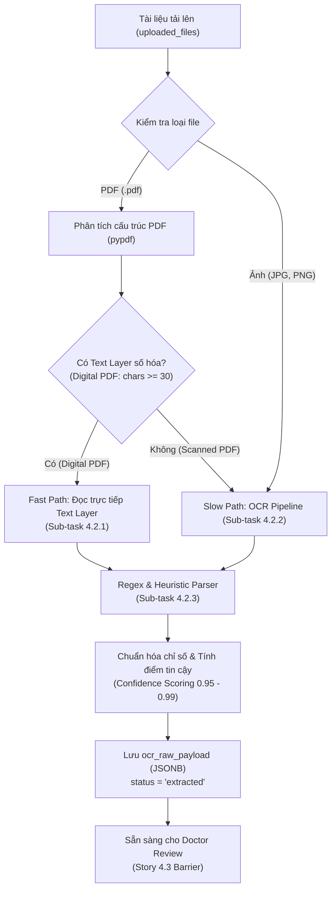

# API CONTRACT & INTERFACE SPECIFICATION
## STORY-4.2: Trích xuất Dữ liệu Cận Lâm Sàng & Động cơ OCR (Paraclinical Data Extraction & OCR Worker Pipeline)

- **Mã Story:** STORY-4.2
- **Tên Story:** Trích xuất Dữ liệu Cận Lâm Sàng & Động cơ OCR
- **Module:** M-INGEST (Tiếp nhận Tài liệu Cận Lâm Sàng & Xử lý Bất đồng bộ)
- **Chuẩn CSDL:** PostgreSQL 16 — Trường `ocr_raw_payload` (JSONB) trong bảng `uploaded_files`.
- **Hạ tầng Tích hợp:**
  - **Object Storage:** MinIO / AWS S3 — Tải dữ liệu nhị phân file gốc thông qua `storage_service.get_file_bytes()`.
  - **Task Queue & Broker:** Celery + Redis — Worker xử lý tác vụ nền ngầm `process_ocr_task`.
- **Liên kết Tasks:**
  - **PRC-44 ([BE] Sub-task 4.2.1):** Xây dựng "Đường nhanh" (Fast path) đọc trực tiếp text layer PDF (Digital PDF Text Layer Extractor).
  - **PRC-45 ([BE] Sub-task 4.2.2):** Xây dựng Pipeline OCR cho tài liệu dạng ảnh / PDF scan (PaddleOCR Engine).
  - **PRC-46 ([BE] Sub-task 4.2.3):** Bộ bóc tách thông minh Regex & Heuristic Parser chuẩn hóa chỉ số sản khoa và xét nghiệm.

---

## 1. TỔNG QUAN KIẾN TRÚC DUAL-PATH INGESTION PIPELINE

Hệ thống xử lý tài liệu cận lâm sàng của PreCare áp dụng kiến trúc rẽ nhánh 2 đường (**Dual-Path Pipeline**) nhằm tối ưu hóa triệt để thời gian phản hồi cho bác sĩ và sản phụ:



### So sánh hiệu năng hai luồng xử lý:

| Tiêu chí | Fast Path (Đường nhanh - Digital PDF) | Slow Path (Đường tiêu chuẩn - OCR Image/Scan) |
| :--- | :--- | :--- |
| **Đối tượng áp dụng** | PDF kết xuất trực tiếp từ máy siêu âm (GE Voluson, Samsung Medison) hoặc phần mềm bệnh viện (HIS/PACS). | Ảnh chụp bằng điện thoại, ảnh scan phẳng, PDF scan không có text layer. |
| **Thời gian xử lý** | **< 1.5 giây** (Tiết kiệm > 90% thời gian) | 5 - 25 giây (Tùy số lượng trang và độ phân giải) |
| **Tài nguyên phần cứng** | Tiêu thụ CPU/RAM cực thấp, không cần GPU. | Cần mô hình Deep Learning OCR (PaddleOCR), tốn RAM/VRAM. |
| **Độ chính xác ký tự** | **98% - 99.5%** (Không bị nhiễu do góc chụp, ánh sáng). | 85% - 95% (Phụ thuộc chất lượng quang học của ảnh chụp). |
| **Sub-task chịu trách nhiệm** | **Sub-task 4.2.1** | **Sub-task 4.2.2** |

---

## 2. SUB-TASK 4.2.1: "ĐƯỜNG NHANH" (FAST PATH) ĐỌC TRỰC TIẾP TEXT LAYER PDF

### 2.1 Tiêu chí nhận diện Digital PDF
1. Định dạng file là `application/pdf` (hoặc đuôi file `.pdf`).
2. Sử dụng thư viện `pypdf` đọc cấu trúc trang nhị phân trực tiếp từ bộ nhớ đệm (in-memory stream).
3. Đọc qua các trang và trích xuất chuỗi ký tự bằng `page.extract_text()`.
4. Nếu tổng số ký tự có nghĩa (non-whitespace characters) $\ge 30$ ký tự:
   - Hệ thống xác định đây là **Digital PDF**.
   - Kích hoạt **Fast Path**, bỏ qua hoàn toàn bước rasterization và OCR nặng.

### 2.2 Quy trình trích xuất & Parser sinh trắc học
Fast Path tích hợp bộ bóc tách Regex & Heuristics chuyên biệt cho phiếu siêu âm sản khoa (tiếng Việt và quốc tế):

| Chỉ số | Tên viết tắt | Tên tiếng Việt trên phiếu | Đơn vị chuẩn | Ngưỡng lâm sàng hợp lệ |
| :--- | :--- | :--- | :--- | :--- |
| **Đường kính lưỡng đỉnh** | `BPD` | Đường kính lưỡng đỉnh, ĐK lưỡng đỉnh, ĐKLD | `mm` | $10.0 \le \text{BPD} \le 120.0$ |
| **Chu vi vòng đầu** | `HC` | Chu vi đầu, Chu vi vòng đầu, CV đầu | `mm` | $50.0 \le \text{HC} \le 400.0$ |
| **Chu vi vòng bụng** | `AC` | Chu vi bụng, Chu vi vòng bụng, CV bụng | `mm` | $50.0 \le \text{AC} \le 450.0$ |
| **Chiều dài xương đùi** | `FL` | Chiều dài xương đùi, CD xương đùi, CDXD | `mm` | $5.0 \le \text{FL} \le 95.0$ |
| **Ước tính cân nặng** | `EFW` | Cân nặng thai ước tính, Trọng lượng thai | `grams` (`g`) | $50.0 \le \text{EFW} \le 6000.0$ |
| **Chiều dài đầu mông** | `CRL` | Chiều dài đầu mông, CD đầu mông (Quý 1) | `mm` | $5.0 \le \text{CRL} \le 120.0$ |
| **Độ mờ da gáy** | `NT` | Độ mờ da gáy, Khoảng sáng sau gáy, ĐMDG | `mm` | $0.5 \le \text{NT} \le 10.0$ |
| **Chỉ số ối** | `AFI` | Chỉ số ối, Chỉ số nước ối | `cm` | $2.0 \le \text{AFI} \le 35.0$ (Tự động đổi mm $\to$ cm) |
| **Nhịp tim thai** | `FHR` | Nhịp tim thai, Tim thai | `bpm` | $80 \le \text{FHR} \le 220$ |
| **Tuổi thai kết luận** | `GA` | Tuổi thai, Thai khoảng | `days` | $14 \le \text{GA} \le 310$ (Quy đổi tuần+ngày $\to$ ngày) |

---

## 3. CẤU TRÚC DỮ LIỆU `ocr_raw_payload` (JSONB)

Khi Fast Path hoàn tất, kết quả được lưu nguyên vẹn vào cột `ocr_raw_payload` của bảng `uploaded_files` trong PostgreSQL 16:

```json
{
  "document_type": "ultrasound_report",
  "extraction_method": "pdf_text_layer_fast_path",
  "is_digital_pdf": true,
  "extracted_fields": {
    "bpd_mm": 77.5,
    "hc_mm": 282.0,
    "ac_mm": 260.0,
    "fl_mm": 57.0,
    "efw_g": 1650.0,
    "crl_mm": null,
    "nt_mm": null,
    "afi_cm": 12.5,
    "fhr_bpm": 145,
    "gestational_age_days": 212
  },
  "raw_text": "PHÒNG KHÁM SẢN PHỤ KHOA TIỀN SẢN PRECARE\nPHIẾU KẾT QUẢ SIÊU ÂM THAI 2D/4D\nBệnh nhân: Nguyễn Thị M. (ID: P-9082)\nNgày siêu âm: 2026-10-18\nTuổi thai theo siêu âm: 30 tuần 2 ngày\nKẾT QUẢ SINH TRẮC THAI:\n- Đường kính lưỡng đỉnh (BPD): 77.5 mm\n- Chu vi vòng đầu (HC): 282.0 mm\n- Chu vi vòng bụng (AC): 260.0 mm\n- Chiều dài xương đùi (FL): 57.0 mm\n- Trọng lượng thai ước tính (EFW - Hadlock IV): 1650 g\n- Chỉ số nước ối (AFI): 12.5 cm\n- Nhịp tim thai (FHR): 145 nhịp/phút\nKẾT LUẬN: Một thai sống trong tử cung tương đương 30 tuần 2 ngày.",
  "confidence_scores": {
    "bpd": 0.99,
    "hc": 0.99,
    "ac": 0.98,
    "fl": 0.99,
    "efw": 0.98,
    "afi": 0.96,
    "fhr": 0.99,
    "ga": 0.97
  },
  "metadata": {
    "total_pages": 1,
    "char_count": 684,
    "is_digital_pdf": true,
    "processing_time_ms": 142,
    "extracted_at": "2026-10-29T11:45:02.124Z"
  }
}
```

---

## 4. CELERY TASK WORKER & POLLING PROGRESSION

### 4.1 Vòng đời tiến trình Task Celery (`process_ocr_task`)

Trong suốt quá trình thực thi của worker, task liên tục cập nhật trạng thái (`self.update_state`) để phía Client (Web Doctor & Mobile App) hiển thị thanh tiến trình trực quan:

| Tiến độ (%) | Giai đoạn (`current_stage`) | Thông điệp hiển thị (`stage_message`) | Thời gian ước tính còn lại |
| :--- | :--- | :--- | :--- |
| **15%** | `queued` | *"Tài liệu đang nằm trong hàng đợi Redis..."* | ~ 10 giây |
| **25%** | `reading_text_layer` | *"Đang phân tích cấu trúc trang và đọc text layer số hóa (Fast Path)..."* | ~ 4 giây |
| **65%** | `extracting_ocr_layout` | *"Đã đọc thành công text layer số hóa. Đang phân tích chỉ số sinh trắc học..."* | ~ 1 giây |
| **100%** | `completed` | *"Trích xuất hoàn tất! Sẵn sàng cho bác sĩ đối chiếu và xác nhận."* | 0 giây |

### 4.2 Tính Idempotency (Bất biến) của Worker
- Celery Task `process_ocr_task` chỉ nhận tham số nguyên thủy: `uploaded_file_id_str: str`.
- Khi chạy lại tác vụ (Retry), worker sẽ tải lại file gốc từ MinIO, trích xuất lại và cập nhật đè lên `ocr_raw_payload` của bản ghi hiện có, tuyệt đối không tạo thêm bản ghi `uploaded_files` mới.

---

## 5. ĐỒNG BỘ CONTRACT CLIENT (TYPESCRIPT INTERFACES)

Đồng bộ với định nghĩa TypeScript tại `web_doctor/src/types/index.ts` và `mobile_app/src/services/api.ts`:

```typescript
export interface ExtractedBiometrics {
  bpd_mm?: number;
  hc_mm?: number;
  ac_mm?: number;
  fl_mm?: number;
  efw_g?: number;
  crl_mm?: number;
  nt_mm?: number;
  afi_cm?: number;
  fhr_bpm?: number;
  gestational_age_days?: number;
}

export interface OCRRawPayload {
  document_type: string;
  extraction_method: 'pdf_text_layer_fast_path' | 'ocr_pipeline_slow_path' | 'manual_entry';
  is_digital_pdf: boolean;
  extracted_fields: ExtractedBiometrics;
  raw_text: string;
  confidence_scores: Record<string, number>;
  metadata: {
    total_pages: number;
    char_count: number;
    is_digital_pdf: boolean;
    processing_time_ms: number;
    extracted_at: string;
    note?: string;
  };
}
```
