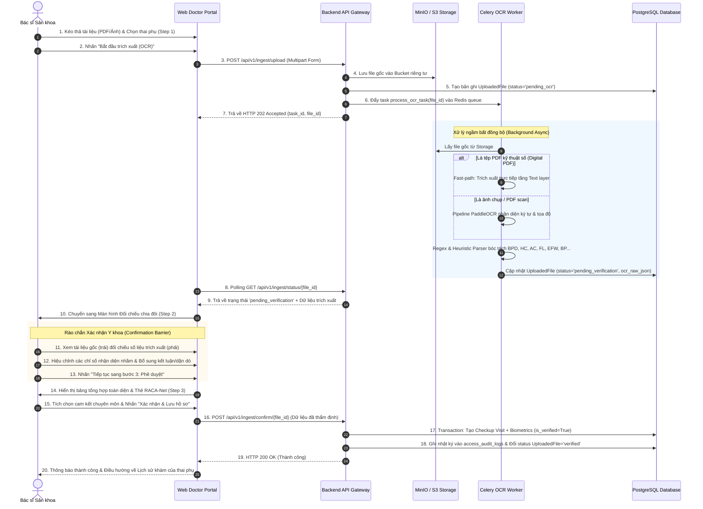
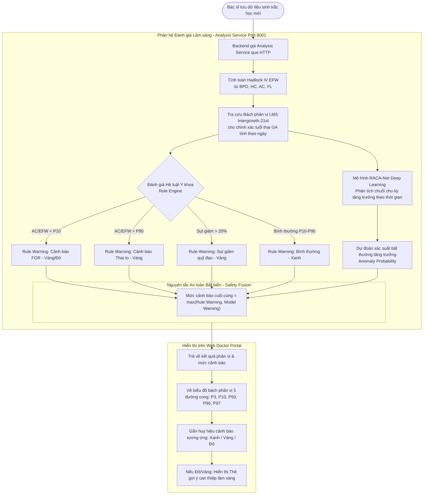
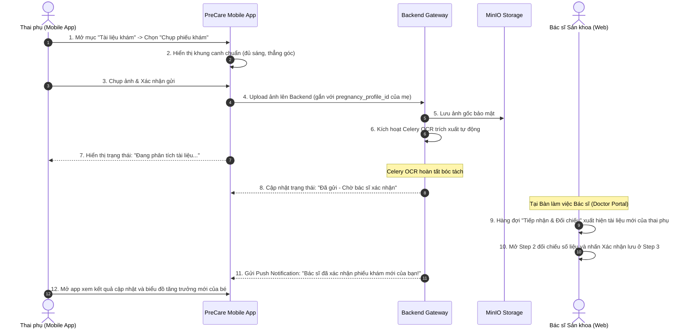
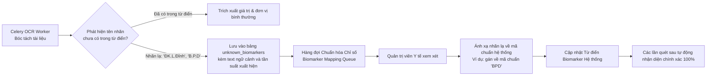

# TÀI LIỆU ĐẶC TẢ CHỨC NĂNG, DANH MỤC MODULE CHUẨN HÓA VÀ CÁC LUỒNG NGHIỆP VỤ HỆ THỐNG PRECARE

> **Hệ thống:** PreCare – Nền tảng số hóa hồ sơ cận lâm sàng và theo dõi quỹ đạo tăng trưởng thai nhi hỗ trợ ra quyết định lâm sàng  
> **Mã dự án:** C1SE.22 (Capstone Project – Đại học Duy Tân)  
> **Phiên bản tài liệu:** Version 1.0 (Đồng bộ theo Architecture Design Document v1.0 & Codebase)  
> **Ngày ban hành:** 24/11/2026  

---

## MỤC LỤC
1. [TỔNG QUAN HỆ THỐNG & MA TRẬN PHÂN QUYỀN VAI TRÒ (ROLES & RBAC MATRIX)](#1-tổng-quan-hệ-thống--ma-trận-phân-quyền-vai-trò)
2. [QUY CHUẨN ĐẶT TÊN CHUẨN HÓA CỦA CÁC MODULE VÀ CHỨC NĂNG](#2-quy-chuẩn-đặt-tên-chuẩn-hóa-của-các-module-và-chức-năng)
3. [MÔ TẢ CÁC CHỨC NĂNG CHÍNH VÀ CHI TIẾT THEO TỪNG VAI TRÒ](#3-mô-tả-các-chức-năng-chính-và-chi-tiết-theo-từng-vai-trò)
   - [3.1. Phân hệ Bác sĩ Sản khoa (Doctor Web Portal)](#31-phân-hệ-bác-sĩ-sản-khoa-doctor-web-portal)
   - [3.2. Phân hệ Thai phụ / Mẹ bầu (Pregnant Woman Mobile App)](#32-phân-hệ-thai-phụ--mẹ-bầu-pregnant-woman-mobile-app)
   - [3.3. Phân hệ Quản trị viên Hệ thống (System Admin Console)](#33-phân-hệ-quản-trị-viên-hệ-thống-system-admin-console)
4. [ĐẶC TẢ CHI TIẾT CÁC LUỒNG HOẠT ĐỘNG HỆ THỐNG (SYSTEM WORKFLOWS)](#4-đặc-tả-chi-tiết-các-luồng-hoạt-động-hệ-thống-system-workflows)
   - [Luồng 1: Tiếp nhận tài liệu $\rightarrow$ OCR ngầm $\rightarrow$ Đối chiếu y khoa $\rightarrow$ Lưu trữ](#luồng-1-tiếp-nhận-tài-liệu--ocr-ngầm--đối-chiếu-y-khoa-confirmation-barrier--lưu-trữ-chính-thức)
   - [Luồng 2: Phân tích tăng trưởng $\rightarrow$ Safety Fusion $\max(\text{rule}, \text{model}) \rightarrow$ Cảnh báo & Trực quan hóa](#luồng-2-phân-tích-tăng-trưởng--safety-fusion-maxrule-model--cảnh-báo--trực-quan-hóa)
   - [Luồng 3: Mối quan hệ tương hỗ giữa "Hồ sơ thai kỳ" và "Tiếp nhận & Đối chiếu cận lâm sàng"](#luồng-3-mối-quan-hệ-tương-hỗ-giữa-hồ-sơ-thai-kỳ-và-tiếp-nhận--đối-chiếu-cận-lâm-sàng)
   - [Luồng 4: Thai phụ chụp ảnh phiếu khám trên Mobile $\rightarrow$ Đồng bộ hàng đợi Bác sĩ](#luồng-4-thai-phụ-chụp-ảnh-phiếu-khám-trên-mobile--đồng-bộ-hàng-đợi-bác-sĩ-duyệt)
   - [Luồng 5: Quản trị viên chuẩn hóa từ điển chỉ số cận lâm sàng lạ (Biomarker Mapping)](#luồng-5-quản-trị-viên-chuẩn-hóa-từ-điển-chỉ-số-cận-lâm-sàng-lạ-unknown-biomarker-mapping)
   - [Luồng 6: Quy trình yêu cầu và xét duyệt xóa hồ sơ bệnh án (Right to Erasure)](#luồng-6-quy-trình-yêu-cầu-và-xét-duyệt-xóa-hồ-sơ-bệnh-án-right-to-erasure-workflow)

---

## 1. TỔNG QUAN HỆ THỐNG & MA TRẬN PHÂN QUYỀN VAI TRÒ

### 1.1. Mục tiêu và Định vị Hệ thống
**PreCare** là hệ thống phần mềm y tế phục vụ chuyên khoa Sản phụ khoa, giải quyết 3 bài toán lâm sàng cốt lõi:
1. **Số hóa và cấu trúc hóa tự động dữ liệu cận lâm sàng:** Chuyển đổi các tài liệu phi cấu trúc (ảnh chụp siêu âm 2D/3D/4D, phiếu xét nghiệm máu, tổng phân tích nước tiểu dạng JPG/PNG/PDF) thành dữ liệu y khoa số có cấu trúc bằng pipeline OCR và mô hình heuristic regex.
2. **Theo dõi dọc quỹ đạo tăng trưởng thai nhi (Longitudinal Fetal Growth Trajectory):** Đánh giá sự phát triển của thai nhi qua chuỗi thời gian dựa trên các chuẩn bách phân vị quốc tế (Hadlock IV, Intergrowth-21st) và mô hình Deep Learning RACA-Net.
3. **Cung cấp rào chắn an toàn kép (Dual Safety Barrier):** Đảm bảo AI chỉ đóng vai trò trợ lý hỗ trợ quyết định lâm sàng (Clinical Decision Support), tuyệt đối không tự ý lưu dữ liệu vào bệnh án khi chưa có bác sĩ thẩm định ký xác nhận (Confirmation Barrier), và mô hình AI không bao giờ được phép hạ mức cảnh báo lâm sàng của hệ luật y tế (Safety Fusion: $\max(\text{rule}, \text{model})$).

---

### 1.2. Ba Vai trò Người dùng Cốt lõi (User Roles)
Hệ thống PreCare phân định ranh giới chức năng và thẩm quyền dữ liệu dựa trên Role-Based Access Control (RBAC):

1. **Bác sĩ Sản khoa (`role: doctor`):**
   - **Môi trường hoạt động:** Ứng dụng Web dành cho Bác sĩ (`web_doctor/`).
   - **Mục tiêu:** Quản lý danh sách thai phụ theo dõi, thực hiện tiếp nhận và đối chiếu dữ liệu OCR từ phiếu khám giấy, theo dõi biểu đồ bách phân vị tăng trưởng thai nhi, nhận diện sớm các nguy cơ bất thường (FGR, thai to, thiểu ối, đa ối), ghi chú dặn dò chuyên môn và xuất báo cáo y khoa.
2. **Thai phụ / Mẹ bầu (`role: pregnant_woman`):**
   - **Môi trường hoạt động:** Ứng dụng Di động (`mobile_app/`).
   - **Mục tiêu:** Tra cứu hồ sơ thai kỳ cá nhân, theo dõi tuổi thai (GA) và ngày dự sinh (EDD), xem lịch khám và nhận thông báo nhắc hẹn, chủ động chụp ảnh phiếu khám/siêu âm tải lên để gửi bác sĩ số hóa, xem biểu đồ cân nặng thai nhi trực quan thân thiện và tải báo cáo hành trình thai kỳ.
3. **Quản trị viên Hệ thống (`role: admin`):**
   - **Môi trường hoạt động:** Phân hệ Quản trị trên Cổng Web (`web_doctor/src/pages/admin/` hoặc các giao diện quản trị tích hợp).
   - **Mục tiêu:** Quản trị người dùng (kích hoạt, khóa/mở tài khoản bác sĩ và thai phụ), chuẩn hóa từ điển ánh xạ chỉ số cận lâm sàng lạ do OCR bóc tách (`Biomarker Mapping Queue`), xét duyệt yêu cầu xóa hồ sơ theo quy định quyền riêng tư y tế, giám sát toàn vẹn hệ thống và nhật ký truy cập (`access_audit_logs`).

---

### 1.3. Ma trận Phân quyền Chức năng và Dữ liệu (RBAC Matrix)

| Thực thể Dữ liệu / Chức năng | Bác sĩ Sản khoa (`doctor`) | Thai phụ (`pregnant_woman`) | Quản trị viên (`admin`) | Ghi chú Ràng buộc An toàn |
| :--- | :---: | :---: | :---: | :--- |
| **Xác thực & Tài khoản cá nhân** | Toàn quyền thông tin cá nhân | Toàn quyền thông tin cá nhân | Quản lý toàn bộ tài khoản | Phân quyền qua JWT Claims & RBAC Middleware |
| **Tạo mới Hồ sơ Thai kỳ** | Tạo mới, cập nhật | Không (Chỉ xem hồ sơ của mình) | Xem, cấu hình hệ thống | Xác định GA chuẩn theo ACOG 700 / Q1 CRL |
| **Xem Hồ sơ Thai kỳ & Diễn biến khám** | Xem mọi bệnh nhân được phân công | Chỉ xem hồ sơ thai kỳ của chính mình | Xem danh sách phục vụ kiểm toán | Tuyệt đối không cho phép mẹ bầu xem chéo bệnh nhân khác |
| **Tải lên tài liệu cận lâm sàng (Upload)** | Tải lên cho bất kỳ thai phụ nào | Tải lên cho chính hồ sơ của mình | Không trực tiếp tải lên | Chấp nhận PDF, JPG, PNG (tối đa 20MB/file, 10 file/lần) |
| **Bóc tách tự động OCR & Parsing** | Được kích hoạt và theo dõi | Được kích hoạt và theo dõi | Xem log xử lý hệ thống | Chạy background qua Celery Worker + Redis broker |
| **Đối chiếu & Hiệu chỉnh OCR (Step 2)** | **Toàn quyền chỉnh sửa, đối chiếu** | Không có quyền (Chỉ đọc khi đã duyệt) | Không can thiệp dữ liệu y khoa | Bắt buộc hiển thị tài liệu gốc đối chiếu song song |
| **Phê duyệt & Lưu vào Bệnh án (Step 3)** | **Độc quyền Bác sĩ (Ký duyệt y khoa)** | Không có quyền | Không có quyền | Dữ liệu chỉ chuyển `is_verified=True` sau bước này |
| **Xem Biểu đồ Tăng trưởng & Cảnh báo** | Xem đầy đủ 5 dải bách phân vị + RACA-Net | Xem biểu đồ cân nặng rút gọn, thân thiện | Xem thống kê tổng hợp | Tuân thủ công thức an toàn $\max(\text{rule}, \text{model})$ |
| **Xuất Báo cáo Y khoa (PDF)** | Báo cáo chi tiết lâm sàng (Doctor PDF) | Báo cáo tóm tắt cho mẹ (Patient PDF) | Xuất báo cáo kiểm toán hệ thống | Bắt buộc gắn Disclaimer miễn trừ trách nhiệm y tế |
| **Ánh xạ chỉ số lạ (Biomarker Mapping)** | Gửi yêu cầu gán nhãn | Không có quyền | **Toàn quyền phê duyệt từ điển** | Quản lý qua bảng `unknown_biomarkers` |
| **Yêu cầu xóa / Hủy hồ sơ** | Gửi yêu cầu xóa kèm lý do | Gửi yêu cầu hủy tài khoản / dữ liệu | **Toàn quyền phê duyệt / Từ chối xóa** | Quy trình phê duyệt 2 cấp (2-Tier Medical Erasure) |
| **Nhật ký truy vết (Audit Trail)** | Ghi log tự động khi xem/sửa | Ghi log tự động khi xem/tải | Xem và xuất log kiểm toán y tế | Lưu IP, User ID, Action, Timestamp vào `access_audit_logs` |

---

## 2. QUY CHUẨN ĐẶT TÊN CHUẨN HÓA CỦA CÁC MODULE VÀ CHỨC NĂNG

### 2.1. Bảng Đối chiếu Tên Module Kỹ thuật và Tên Hiển thị trên UI

Để loại bỏ hoàn toàn sự nhập nhằng giữa các khái niệm kỹ thuật và ngôn ngữ lâm sàng, hệ thống PreCare quy định bảng tên chuẩn hóa xuyên suốt như sau:

| Mã Module (ADD v1.0) | Tên Kỹ thuật Backend | Tên Hiển thị UI Bác sĩ (Doctor Portal) | Tên Hiển thị UI Thai phụ (Mobile App) | Tên Hiển thị UI Quản trị (Admin Portal) |
| :--- | :--- | :--- | :--- | :--- |
| **`M-AUTH`** | Authentication & RBAC | **Xác thực & Phân quyền** | **Đăng nhập & Tài khoản** | **Quản trị Tài khoản & Phân quyền** |
| **`M-RECORD`** | Pregnancy Profile & Visits | **Hồ sơ thai kỳ** (Cấp danh sách)<br>$\rightarrow$ **Lịch sử khám & Cận lâm sàng** (Cấp chi tiết) | **Nhật ký thai kỳ**<br>$\rightarrow$ **Lịch sử lần khám** | **Quản lý Hồ sơ Bệnh án Điện tử** |
| **`M-INGEST`** | Document Ingest & OCR Queue | **Tiếp nhận & Đối chiếu cận lâm sàng**<br>$\rightarrow$ Thao tác: **Tải hồ sơ** | **Tài liệu khám**<br>$\rightarrow$ Thao tác: **Chụp / Tải phiếu khám** | **Giám sát Hàng đợi Số hóa Tài liệu** |
| **`M-ANALYSIS`** | Clinical Rule & RACA-Net Engine | **Động cơ Đánh giá Lâm sàng & AI** | *(Chạy ngầm - Hiển thị trạng thái sức khỏe)* | **Cấu hình Ngưỡng & Phiên bản Mô hình** |
| **`M-VIZ`** | Trajectory Charts & Percentiles | **Biểu đồ Tăng trưởng Thai nhi** (Đủ 5 dải bách phân vị) | **Cân nặng & Sự phát triển của bé** (Trực quan, dễ hiểu) | **Thống kê Bách phân vị Toàn viện** |
| **`M-REPORT`** | Medical PDF Generation | **Báo cáo Y khoa Lâm sàng** | **Báo cáo Hành trình Thai kỳ** | **Kiểm toán Báo cáo Xuất khẩu** |
| **`M-ADMIN`** | System Administration & Mapping | *(Bác sĩ gửi đề xuất chỉ số lạ)* | *(Không hiển thị)* | **Chuẩn hóa Chỉ số Cận lâm sàng** & **Xét duyệt Xóa hồ sơ** |

---

### 2.2. Giải Quyết Triệt Để Ranh Giới Giữa Các Thuật Ngữ Nhạy Cảm

#### 1. Vì sao KHÔNG dùng tên "Kết quả xét nghiệm"?
- **Nguyên nhân y khoa:** Khái niệm "Xét nghiệm" (Laboratory Tests) trong y khoa chỉ bao gồm sinh hóa máu, tổng phân tích nước tiểu, xét nghiệm miễn dịch/gen (Double test, Triple test, NIPT). Trong khi đó, tài liệu trọng tâm nhất của PreCare là **Phiếu siêu âm sản khoa 2D/3D/4D**, cung cấp các số đo sinh trắc học đầu - bụng - đùi (BPD, HC, AC, FL). Gọi là "Kết quả xét nghiệm" sẽ làm sai lệch bản chất chuyên môn, khiến bác sĩ hiểu nhầm hệ thống chỉ quản lý ống máu và nước tiểu mà bỏ quên siêu âm thai.
- **Biểu tượng (Icon):** Sử dụng biểu tượng quét tài liệu / số hóa `ScanText` hoặc `FileText`, thay vì biểu tượng ống nghiệm hóa học `FlaskConical`.

#### 2. Vì sao KHÔNG dùng tên "Document Upload & OCR Worker"?
- **Nguyên nhân trải nghiệm người dùng:** "Document Upload & OCR Worker" là tên định danh kỹ thuật trong tài liệu kiến trúc phần mềm (Software Architecture Document). Người dùng cuối là Bác sĩ Sản khoa không cần biết về tiến trình nền `Celery Worker`, `Redis Broker` hay thư viện `PaddleOCR`. Bác sĩ cần một thuật ngữ phản ánh đúng thao tác nghiệp vụ lâm sàng: **"Tiếp nhận & Đối chiếu cận lâm sàng"**.

#### 3. Vì sao KHÔNG dùng tên "Hồ sơ cận lâm sàng" trên thanh Menu chính?
- **Nguyên nhân tránh trùng lặp nhận thức:** Menu chính đã có mục **"Hồ sơ thai kỳ"**. Nếu đặt thêm mục **"Hồ sơ cận lâm sàng"** sẽ khiến người dùng bối rối vì có tới hai mục đều mang chữ "Hồ sơ", không rõ xem thông tin bệnh nhân ở đâu.
- **Quy chuẩn chuẩn hóa phân cấp:**
  - Cấp thanh điều hướng chính (Sidebar Navigation): **`Tiếp nhận & Đối chiếu cận lâm sàng`** (Đây là khu vực hàng đợi công việc - Worklist Queue, gom tất cả tài liệu mới tải lên chờ bóc tách và duyệt).
  - Cấp quản lý hồ sơ bệnh nhân (Patient Profile Detail): **`Hồ sơ thai kỳ`** $\rightarrow$ Tab **`Lịch sử khám & Cận lâm sàng`** (Xem diễn biến lần khám, chi tiết từng chỉ số và file gốc gắn với bệnh nhân đó).
  - Nút hành động tải tài liệu: Đặt tên chuẩn xác là **`Tải hồ sơ`** (Thay thế hoàn toàn chữ "Up hồ sơ" hoặc "Tải lên 3 phiếu mẫu").

---

## 3. MÔ TẢ CÁC CHỨC NĂNG CHÍNH VÀ CHI TIẾT THEO TỪNG VAI TRÒ

```
                             HỆ THỐNG PRECARE (C1SE.22)
     ____________________________________|____________________________________
    |                                    |                                    |
[PHÂN HỆ BÁC SĨ]                 [PHÂN HỆ THAI PHỤ]                 [PHÂN HỆ QUẢN TRỊ]
(Web Doctor Portal)              (Mobile Companion)                 (Admin Console)
- Tổng quan ca khám              - Trang chủ đếm ngược tuần thai    - Quản lý tài khoản & RBAC
- Hồ sơ thai kỳ & Timeline       - Lịch khám & Nhắc hẹn tự động     - Chuẩn hóa chỉ số lạ
- Tiếp nhận & Đối chiếu OCR      - Sổ tay tài liệu & Chụp phiếu     - Xét duyệt yêu cầu xóa
- Biểu đồ tăng trưởng 5 dải      - Biểu đồ cân nặng bé đơn giản hóa - Nhật ký truy vết an toàn
- Xuất báo cáo y khoa (PDF)      - Tải phiếu tóm tắt cho mẹ         - Thống kê hệ thống
```

---

### 3.1. Phân hệ Bác sĩ Sản khoa (Doctor Web Portal)

#### 3.1.1. Chức năng Tổng quan Lâm sàng (Dashboard)
- **Mã chức năng:** `DOC-DASH`
- **Mô tả:** Bàn làm việc trung tâm cung cấp bức tranh toàn cảnh về hoạt động khám trong ngày.
- **Các tính năng chi tiết:**
  - Thống kê nhanh theo thời gian thực (KPI Cards): Tổng số thai phụ đang quản lý, số ca khám hôm nay, số tài liệu cận lâm sàng đang chờ đối chiếu (`pending_verification`), số ca có cảnh báo nguy cơ cao (FGR/Thai to).
  - Danh sách ca khám tiếp theo trong ngày kèm cảnh báo tuần thai quan trọng (ví dụ: mốc 12 tuần đo độ mờ da gáy NT, mốc 22 tuần siêu âm hình thái học).
  - Lối tắt truy cập nhanh: "Tạo hồ sơ thai kỳ mới", "Tiếp nhận cận lâm sàng ngay".

#### 3.1.2. Chức năng Quản lý Hồ sơ Thai kỳ & Diễn biến Khám (`M-RECORD`)
- **Mã chức năng:** `DOC-REC`
- **Mô tả:** Quản lý toàn diện dữ liệu nhân khẩu học, tiền sử sản khoa và diễn biến thăm khám của từng thai phụ qua chuỗi thời gian.
- **Các tính năng chi tiết:**
  - **Danh sách hồ sơ thai kỳ:** Hiển thị danh bạ thai phụ, lọc theo tuổi thai (Tam cá nguyệt 1, 2, 3), phân loại nhóm nguy cơ (Bình thường / Cần theo dõi / Nguy cơ cao), tìm kiếm tức thời theo họ tên, số điện thoại hoặc mã bệnh nhân (PID).
  - **Nút hành động chuẩn hóa:** Đổi tên nút hành động từ `"Xem bệnh án"` thành `"Xem hồ sơ"` để phản ánh đúng tính chất chăm sóc liên tục suốt thai kỳ.
  - **Khởi tạo hồ sơ thai kỳ mới:**
    - Nhập thông tin hành chính thai phụ, tiền sử bệnh nền, số lần mang thai (PARA: Sinh - Sống - Sảy - Hút).
    - Tính toán tuổi thai chuẩn: Tự động tính ngày dự sinh (EDD) và tuổi thai (GA) theo Ngày đầu kỳ kinh cuối (LMP) theo chuẩn ACOG 700 hoặc hiệu chỉnh bằng số đo chiều dài đầu mông (CRL) trong tam cá nguyệt 1.
    - Quy tắc lưu trữ GA: Lưu trữ dạng số nguyên ngày (`days`) trong cơ sở dữ liệu PostgreSQL (ví dụ `226` ngày), chỉ format sang `"32w 2d"` (`32 tuần 2 ngày`) tại tầng giao diện.
  - **Dòng thời gian các lần khám (Visits Timeline):**
    - Trực quan hóa toàn bộ lịch sử các lần khám theo thứ tự thời gian giảm dần hoặc tăng dần.
    - Mỗi lần khám hiển thị: Ngày khám, tuổi thai tại thời điểm khám, phân loại lần khám (Khám định kỳ, Siêu âm chuyên sâu, Khám cấp cứu), tóm tắt các chỉ số chính (Tim thai FHR, EFW, Huyết áp).
    - Nút thao tác **`Tải hồ sơ`** trực tiếp tại mỗi lần khám hoặc ở đầu trang để bổ sung tài liệu mới.
  - **Xem chi tiết lần khám (Checkup Detail Modal / Drawer):**
    - Cho phép bác sĩ click vào bất kỳ lần khám nào trong quá khứ để xem lại toàn bộ:
      1. Bảng chỉ số sinh trắc học thai nhi chi tiết (BPD, HC, AC, FL, EFW, AFI).
      2. Chỉ số sinh hiệu thai phụ (Huyết áp, Cân nặng, Chiều cao, BMI, Mạch, Thân nhiệt).
      3. Kết quả xét nghiệm sinh hóa máu & que nhúng nước tiêu (Hb, Glucose, Protein niệu).
      4. Kết luận chuyên môn và lời dặn dò điều trị của bác sĩ.
      5. Bộ tài liệu gốc đã số hóa đính kèm (cho phép click mở xem lại file ảnh scan hoặc PDF gốc).

#### 3.1.3. Chức năng Tiếp nhận & Đối chiếu Cận lâm sàng (`M-INGEST`)
- **Mã chức năng:** `DOC-INGEST`
- **Mô tả:** Trạm số hóa và đối chiếu kết quả cận lâm sàng với rào chắn xác nhận y khoa (Confirmation Barrier).
- **Các tính năng chi tiết:**
  - **Hàng đợi công việc (Ingest Worklist Queue):**
    - Bảng danh sách các tài liệu cận lâm sàng đã tải lên hệ thống.
    - Bộ lọc trạng thái: `Đang trích xuất (Processing)`, `Chờ đối chiếu (Pending Review)`, `Đã xác nhận (Verified)`, `Lỗi trích xuất (Failed)`.
    - Thẻ thống kê nhanh: Số tài liệu cần xử lý ngay trong ca trực.
  - **Quy trình bóc tách và đối chiếu 3 bước (3-Step Verification Wizard):**
    - **Bước 1: Tải tài liệu (`Step 1: Upload`):**
      - Vùng kéo thả file hiện đại hỗ trợ định dạng `.pdf`, `.jpg`, `.png`, tối đa 10 tệp/lần, dung lượng tối đa 20MB/tệp.
      - Hộp chọn thai phụ (nếu truy cập từ menu chung) hoặc tự động gắn mã thai phụ (nếu tải từ trang chi tiết hồ sơ).
      - Danh sách tệp đã chọn kèm thanh tiến trình upload thực tế (`Progress bar`), kích thước file, nút xóa file trước khi gửi.
      - Khung hướng dẫn chụp phiếu chuẩn y tế và cam kết bảo mật thông tin hồ sơ y tế.
      - Nút kích hoạt: `"Bắt đầu trích xuất (OCR)"`.
    - **Bước 2: Xử lý & Đối chiếu dữ liệu trích xuất AI (`Step 2: Split-Screen Review`):**
      - Hỗ trợ chế độ duyệt đơn lẻ (Single file) hoặc duyệt hàng loạt (Batch review với thẻ chuyển đổi danh sách tệp).
      - **Nửa trái màn hình (Document Viewer):** Hiển thị trực tiếp tệp scan gốc (PDF/Ảnh) kèm công cụ phóng to, thu nhỏ, xoay ảnh, lật trang để đối chiếu song song.
      - **Nửa phải màn hình (Verification Forms):** Form nhập liệu chia theo các nhóm chuyên môn, tự động điền các giá trị OCR trích xuất được:
        1. *Thông tin lần khám:* Ngày khám, bác sĩ thực hiện, cơ sở khám.
        2. *Chỉ số sinh hiệu mẹ:* Huyết áp, mạch, cân nặng, BMI.
        3. *Sinh trắc học thai nhi 4D:* BPD, HC, AC, FL, Tim thai (FHR), Chỉ số ối (AFI).
        4. *Xét nghiệm huyết học & Nước tiểu:* HGB, Đường huyết, Protein niệu, Bạch cầu niệu.
        5. *Thẻ cảnh báo lâm sàng RACA-Net:* Hiển thị khuyến nghị AI dựa trên các số đo trích xuất (được tô màu theo mức cảnh báo).
        6. *Kết luận chuyên môn & Dặn dò:* Cho phép bác sĩ bổ sung chỉ định hoặc chỉnh sửa lời dặn.
      - Mọi ô dữ liệu đều cho phép bác sĩ nhấp vào chỉnh sửa trực tiếp nếu OCR nhận diện nhầm.
    - **Bước 3: Kiểm tra tổng hợp & Phê duyệt lưu vào hồ sơ điện tử (`Step 3: Approval`):**
      - Bảng tổng hợp toàn bộ các thông số đã đối chiếu ở Bước 2 dưới dạng báo cáo hoàn chỉnh.
      - Thẻ cảnh báo lâm sàng tổng hợp (RACA-Net Clinical Alert Card).
      - Khu vực chữ ký điện tử y tế: Xác thực danh tính bác sĩ duyệt hồ sơ.
      - Hộp kiểm xác nhận trách nhiệm chuyên môn bắt buộc:
        - `[x] Tôi đã kiểm tra đối chiếu dữ liệu trích xuất với phiếu khám gốc và chịu trách nhiệm chuyên môn.`
        - `[x] Gửi thông báo và cập nhật dữ liệu vào ứng dụng dành cho mẹ bầu (PreCare Mom App).`
      - Nút hoàn tất: `"Xác nhận & Lưu hồ sơ"` $\rightarrow$ Cập nhật cơ sở dữ liệu chính thức và điều hướng về trang Lịch sử khám của thai phụ.

#### 3.1.4. Chức năng Theo dõi Quỹ đạo Tăng trưởng & Cảnh báo Lâm sàng (`M-ANALYSIS` & `M-VIZ`)
- **Mã chức năng:** `DOC-VIZ`
- **Mô tả:** Trực quan hóa dữ liệu sinh trắc học theo chuỗi thời gian, áp dụng các đường cong tham chiếu quốc tế và thuật toán phát hiện nguy cơ sớm.
- **Các tính năng chi tiết:**
  - **Biểu đồ bách phân vị chuẩn 5 dải:**
    - Trực quan hóa 5 chỉ số sinh trắc học thiết yếu: Đường kính lưỡng đỉnh (BPD), Chu vi đầu (HC), Chu vi bụng (AC), Chiều dài xương đùi (FL), Cân nặng ước tính thai nhi (EFW).
    - Hiển thị đầy đủ 5 đường cong bách phân vị tham chiếu chuẩn Hadlock / Intergrowth-21st: **3rd, 10th, 50th, 90th, 97th percentiles**.
    - Các điểm khám thực tế của thai nhi được vẽ thành đường quỹ đạo liên tục, có thể phóng to, thu nhỏ và tooltip chi tiết từng ngày khám.
  - **Hệ thống cảnh báo cờ đỏ lâm sàng (Red Flag Alerts):**
    - *Thai chậm tăng trưởng trong tử cung (FGR):* Tự động kích hoạt khi EFW hoặc AC $< 10\text{th}$ percentile (mức Nghiêm trọng nếu $< 3\text{rd}$ percentile).
    - *Thai to / Nguy cơ đẻ khó (LGA / Macrosomia):* Tự động kích hoạt khi EFW hoặc AC $> 90\text{th}$ percentile.
    - *Hiện tượng sụt giảm quỹ đạo tăng trưởng (Growth Trajectory Drop):* Cảnh báo khi chu vi bụng hoặc cân nặng sụt giảm $> 20$ percentile giữa hai lần khám liên tiếp (dấu hiệu cảnh báo suy thai tiềm ẩn dù giá trị vẫn nằm trong ngưỡng 10-90%).
    - *Bất thường chỉ số ối (AFI):* Cảnh báo Thiểu ối ($< 5\text{ cm}$) hoặc Đa ối ($> 24\text{ cm}$).
    - *Độ mờ da gáy (NT):* Cảnh báo nguy cơ bất thường nhiễm sắc thể nếu $\ge 3.0\text{ mm}$ (đo ở tuần 11w0d - 13w6d).
  - **Nguyên tắc an toàn Safety Fusion bất biến:**
    $$\text{Final Warning Level} = \max(\text{Clinical Rule Level}, \text{Model Prediction Level})$$
    Mô hình học sâu RACA-Net chỉ được phép phát hiện sớm để nâng mức cảnh báo, tuyệt đối không bao giờ được phép hạ mức cảnh báo của hệ luật y tế.
  - **Bảng so sánh biến thiên giữa các lần khám (Delta Comparison Table):** So sánh tốc độ tăng trưởng thực tế của thai nhi giữa 2 lần khám gần nhất so với tốc độ chuẩn trung bình.

#### 3.1.5. Chức năng Xuất Báo cáo Y khoa Chuyên nghiệp (`M-REPORT`)
- **Mã chức năng:** `DOC-REP`
- **Mô tả:** Tạo báo cáo tóm tắt quá trình theo dõi thai kỳ định dạng PDF chuẩn y tế.
- **Các tính năng chi tiết:**
  - Tích hợp tiêu đề bệnh viện/phòng khám, mã số hồ sơ bệnh nhân, thông tin thai phụ.
  - Tóm tắt các chỉ số khám gần nhất kèm bảng đối chiếu bách phân vị và biểu đồ tăng trưởng thu nhỏ.
  - Ghi nhận đầy đủ chẩn đoán, dặn dò của bác sĩ điều trị và chữ ký điện tử.
  - Điều khoản miễn trừ trách nhiệm y tế chuẩn (Medical Legal Disclaimer) được tự động nhúng ở chân trang.

---

### 3.2. Phân hệ Thai phụ / Mẹ bầu (Pregnant Woman Mobile App)

#### 3.2.1. Chức năng Trang chủ & Đếm ngược Thai kỳ (Home & Countdown)
- **Mã chức năng:** `MOM-HOME`
- **Mô tả:** Màn hình chào mừng ấm áp, cá nhân hóa theo từng ngày của thai kỳ.
- **Các tính năng chi tiết:**
  - Hiển thị tuổi thai hiện tại chính xác đến từng ngày (Ví dụ: *"32 tuần 4 ngày"*).
  - Đếm ngược số ngày đến Ngày dự sinh (EDD).
  - Thẻ thông tin kích thước và cân nặng ước lượng của thai nhi tương đương với một loại trái cây/rau củ gần gũi.
  - Cảnh báo các mốc xét nghiệm quan trọng của tam cá nguyệt hiện tại.

#### 3.2.2. Chức năng Nhật ký Thai kỳ & Biểu đồ Thân thiện (`M-RECORD` & `M-VIZ`)
- **Mã chức năng:** `MOM-REC`
- **Mô tả:** Giúp mẹ bầu theo dõi hành trình phát triển của con một cách trực quan, không gây lo âu.
- **Các tính năng chi tiết:**
  - Lịch sử các lần khám đã được bác sĩ xác nhận (`Verified`).
  - Biểu đồ cân nặng thai nhi đơn giản hóa: Chỉ hiển thị vùng cân nặng chuẩn (10th - 90th percentile dạng dải màu xanh dịu mắt) và đường cân nặng của bé.
  - Chú thích trạng thái thân thiện (Ví dụ: *"Bé đang phát triển rất tốt và nằm trong chuẩn cân nặng khỏe mạnh"*).

#### 3.2.3. Chức năng Sổ tay Tài liệu & Chụp Phiếu Khám (`M-INGEST`)
- **Mã chức năng:** `MOM-DOC`
- **Mô tả:** Cho phép thai phụ lưu trữ và gửi tài liệu khám cho bác sĩ.
- **Các tính năng chi tiết:**
  - Chụp ảnh trực tiếp bằng camera điện thoại hoặc chọn ảnh từ thư viện (phiếu siêu âm, kết quả xét nghiệm).
  - Khung hướng dẫn chụp thông minh: Nhắc nhở mẹ chụp thẳng, đủ sáng, không bị bóng mờ để hệ thống nhận diện tốt nhất.
  - Danh sách tài liệu đã gửi kèm trạng thái xử lý: `Đang xử lý` $\rightarrow$ `Chờ bác sĩ duyệt` $\rightarrow$ `Đã lưu vào hồ sơ`.
  - Mẹ bầu có thể xem lại file ảnh scan gốc bất cứ lúc nào.

#### 3.2.4. Chức năng Quản lý Lịch hẹn Khám thai (Appointments)
- **Mã chức năng:** `MOM-APPT`
- **Mô tả:** Quản lý lịch khám định kỳ do bác sĩ chỉ định.
- **Các tính năng chi tiết:**
  - Xem danh sách lịch hẹn khám thai sắp tới.
  - Nhận thông báo tự động (Push Notification) trước ngày khám 1 ngày và 2 giờ.
  - Gợi ý danh sách câu hỏi cần hỏi bác sĩ trong lần khám tới.

#### 3.2.5. Chức năng Tải Báo cáo Hành trình Thai kỳ (`M-REPORT`)
- **Mã chức năng:** `MOM-REP`
- **Mô tả:** Cho phép mẹ bầu tải về file PDF tóm tắt hành trình mang thai để lưu làm kỷ niệm hoặc tham khảo khi chuyển tuyến sinh nở.

---

### 3.3. Phân hệ Quản trị viên Hệ thống (System Admin Console)

#### 3.3.1. Chức năng Quản trị Người dùng & Phân quyền (`M-AUTH`)
- **Mã chức năng:** `ADM-USER`
- **Mô tả:** Quản lý tài khoản toàn bộ nhân sự y tế và người dùng trong hệ thống.
- **Các tính năng chi tiết:**
  - Danh sách người dùng, lọc theo vai trò (`doctor`, `pregnant_woman`, `admin`).
  - Thao tác khóa / mở khóa tài khoản người dùng (`is_active = True/False`).
  - Cấp quyền bác sĩ, cập nhật thông tin khoa phòng, số hiệu chứng chỉ hành nghề.

#### 3.3.2. Chức năng Chuẩn hóa Từ điển Chỉ số Cận lâm sàng Lạ (`M-ADMIN`)
- **Mã chức năng:** `ADM-MAPPING`
- **Mô tả:** Hàng đợi xử lý các nhãn chỉ số mà OCR đọc được từ các phòng khám/bệnh viện khác nhau nhưng chưa có trong từ điển chuẩn (`Biomarker Mapping Queue`).
- **Các tính năng chi tiết:**
  - Danh sách các nhãn lạ được tự động đẩy vào bảng `unknown_biomarkers` kèm tần suất xuất hiện và đoạn văn bản gốc chứa nhãn.
  - Giao diện cho phép Quản trị viên y tế gán nhãn lạ đó về một mã chuẩn (Ví dụ: Nhãn `"ĐK Lưỡng Đỉnh"`, `"B.P.D"` $\rightarrow$ Chuẩn hóa về mã `BPD`).
  - Sau khi ánh xạ, toàn bộ các lần quét sau này sẽ tự động nhận diện chính xác chỉ số này.

#### 3.3.3. Chức năng Xét duyệt Yêu cầu Xóa Hồ sơ Y tế (Deletion Requests Review)
- **Mã chức năng:** `ADM-DEL`
- **Mô tả:** Thực thi quyền được lãng quên / xóa dữ liệu y tế (Right to Erasure) theo quy định pháp lý và bảo mật.
- **Các tính năng chi tiết:**
  - Hàng đợi tiếp nhận các yêu cầu xóa hồ sơ do Bác sĩ hoặc Thai phụ gửi lên kèm lý do bắt buộc.
  - Quy trình xét duyệt 2 cấp: Đánh giá hồ sơ $\rightarrow$ Phê duyệt xóa mềm (`soft delete` với mốc thời gian lưu trữ theo luật lưu trữ bệnh án) hoặc từ chối xóa kèm phản hồi lý do y khoa.

#### 3.3.4. Chức năng Giám sát & Nhật ký Truy vết An toàn (`access_audit_logs`)
- **Mã chức năng:** `ADM-AUDIT`
- **Mô tả:** Giám sát toàn vẹn hệ thống và bảo mật dữ liệu y tế cá nhân (Zero PII in Plain Logs).
- **Các tính năng chi tiết:**
  - Ghi nhận tự động mọi thao tác: Đọc hồ sơ bệnh nhân, Sửa số liệu trích xuất OCR, Tải file siêu âm, Xuất báo cáo PDF.
  - Lưu trữ định danh người thao tác, IP, thời điểm và tài nguyên truy cập, hỗ trợ tra cứu khi xảy ra sự cố bảo mật thông tin y tế.

---

## 4. ĐẶC TẢ CHI TIẾT CÁC LUỒNG HOẠT ĐỘNG HỆ THỐNG (SYSTEM WORKFLOWS)

### Luồng 1: Tiếp nhận tài liệu $\rightarrow$ OCR ngầm $\rightarrow$ Đối chiếu y khoa (Confirmation Barrier) $\rightarrow$ Lưu trữ chính thức

Đây là luồng nghiệp vụ xương sống của hệ thống PreCare. Dữ liệu từ tài liệu giấy chuyển thành hồ sơ y tế số bắt buộc phải đi qua rào chắn xác nhận của bác sĩ.



---

### Luồng 2: Phân tích tăng trưởng $\rightarrow$ Safety Fusion $\max(\text{rule}, \text{model}) \rightarrow$ Cảnh báo & Trực quan hóa

Đảm bảo an toàn y khoa tối đa: Mô hình trí tuệ nhân tạo chỉ được nâng mức cảnh báo nguy cơ, không được phép hạ mức cảnh báo của quy chuẩn y tế.



---

### Luồng 3: Mối quan hệ tương hỗ giữa "Hồ sơ thai kỳ" và "Tiếp nhận & Đối chiếu cận lâm sàng"

Giải thích rõ ràng sự khác biệt về góc nhìn và cách người dùng luân chuyển giữa 2 chức năng trên Sidebar:

```
               [THANH SIDEBAR PRECARE DOCTOR PORTAL]
                 |                               |
                 v                               v
    +-------------------------+     +-------------------------------+
    |     HỒ SƠ THAI KỲ       |     |  TIẾP NHẬN & ĐỐI CHIẾU CLS    |
    | (Patient-Centric View)  |     |     (Task-Centric View)       |
    +-------------------------+     +-------------------------------+
                 |                               |
                 | Quản lý DỌC theo từng mẹ bầu  | Quản lý NGANG theo công việc
                 |                               |
                 v                               v
     [Danh sách tất cả thai phụ]     [Hàng đợi tất cả file mới tải]
                 |                               |
                 | Click "Xem hồ sơ"             | Click "Đối chiếu"
                 v                               v
     [Chi tiết thai phụ cụ thể]     [Wizard 3 bước đối chiếu OCR]
      - Tab: Lịch sử khám & CLS                   |
      - Tab: Biểu đồ tăng trưởng                  | Sau khi bác sĩ duyệt Bước 3:
      - Nút: "Tải hồ sơ"                          | Dữ liệu tự động đồng bộ sang:
                 |                               |
                 +<------------------------------+
```

1. **Hồ sơ thai kỳ (Patient-Centric Longitudinal View):**
   - **Góc nhìn:** Quản lý theo từng bệnh nhân qua toàn bộ hành trình mang thai (40 tuần).
   - **Mục đích sử dụng:** Khi bác sĩ đang ngồi đối thoại trực tiếp với thai phụ trong phòng khám. Bác sĩ mở hồ sơ để xem lại toàn bộ tiền sử, dòng thời gian các lần khám trước, biểu đồ tăng trưởng thai nhi và các chỉ định dặn dò.
   - **Hành động tại đây:** Nhấn nút `"Tải hồ sơ"` ngay trên màn hình chi tiết lần khám để bổ sung tài liệu cho đúng bệnh nhân này.

2. **Tiếp nhận & Đối chiếu cận lâm sàng (Task-Centric Ingest Worklist View):**
   - **Góc nhìn:** Quản lý theo hàng đợi tác vụ xử lý tài liệu.
   - **Mục đích sử dụng:** Khi bác sĩ hoặc kỹ thuật viên có một xấp phiếu khám/ảnh siêu âm mới thu thập từ phòng siêu âm hoặc do bệnh nhân gửi lên từ ứng dụng di động. Đây là nơi gom chung toàn bộ tài liệu chưa được số hóa hoặc đang chờ duyệt.
   - **Hành động tại đây:** Kéo thả tệp hàng loạt, theo dõi tiến độ OCR, mở màn hình đối chiếu chia đôi và ký duyệt hàng loạt để hoàn tất công việc hành chính số hóa.

---

### Luồng 4: Thai phụ chụp ảnh phiếu khám trên Mobile $\rightarrow$ Đồng bộ hàng đợi Bác sĩ duyệt



---

### Luồng 5: Quản trị viên chuẩn hóa từ điển chỉ số cận lâm sàng lạ (Unknown Biomarker Mapping)



---

### Luồng 6: Quy trình yêu cầu và xét duyệt xóa hồ sơ bệnh án (Right to Erasure Workflow)

Tuân thủ nghiêm ngặt quy định bảo mật dữ liệu y tế (Medical Data Privacy) và luật lưu trữ hồ sơ bệnh án:

1. **Khởi tạo yêu cầu:** Bác sĩ hoặc Thai phụ gửi yêu cầu xóa một lần khám hoặc hồ sơ thai kỳ qua nút chức năng, bắt buộc nhập lý do chi tiết (Ví dụ: *"Hồ sơ nhập trùng lặp"*, *"Phiếu khám sai người bệnh"*).
2. **Tiếp nhận vào Hàng đợi Quản trị:** Yêu cầu được đưa vào phân hệ `Xét duyệt xóa hồ sơ` của Quản trị viên hệ thống. Hồ sơ gốc được tạm khóa ở trạng thái `pending_deletion` (không cho phép chỉnh sửa thêm).
3. **Thẩm định chuyên môn:** Quản trị viên kiểm tra tính hợp lệ của lý do xóa và đối chiếu quy chế lưu trữ y tế.
4. **Phê duyệt hoặc Từ chối:**
   - Nếu *Từ chối:* Mở khóa hồ sơ trở lại trạng thái bình thường, gửi thông báo kèm lý do từ chối.
   - Nếu *Phê duyệt:* Thực hiện thao tác xóa mềm (`soft delete` - đánh dấu `deleted_at`, ẩn khỏi toàn bộ giao diện Bác sĩ và Thai phụ nhưng giữ vết trong cơ sở dữ liệu kiểm toán phục vụ thanh tra y tế), ghi nhận hành động vào `access_audit_logs`.

---

## 5. TỔNG KẾT VÀ NGUYÊN TẮC ÁP DỤNG TRÊN TOÀN HỆ THỐNG

1. **Nhất quán tên gọi:** Từ nay trên toàn bộ giao diện Web Bác sĩ, Mobile Thai phụ, mã nguồn (Codebase) và tài liệu kỹ thuật, mọi thành viên và AI Agent bắt buộc sử dụng chuẩn tên gọi đã định nghĩa tại **Mục 2**.
2. **Tuyệt đối không vi phạm Rào chắn Xác nhận (Confirmation Barrier):** Không có bất kỳ dòng dữ liệu cận lâm sàng nào từ OCR được phép tự động ghi vào bảng bệnh án chính thức nếu chưa có thao tác nhấn duyệt tại Bước 3 của Bác sĩ.
3. **Bất biến An toàn Safety Fusion:** Trong mọi trường hợp đánh giá cảnh báo, công thức $\max(\text{rule}, \text{model})$ là bất biến để đảm bảo tính an toàn y khoa cao nhất cho sức khỏe của mẹ và thai nhi.

---
*Tài liệu này là căn cứ chuẩn hóa chính thức chi phối toàn bộ quá trình phát triển Frontend, Backend, AI Microservice và Kiểm thử của dự án PreCare (C1SE.22).*